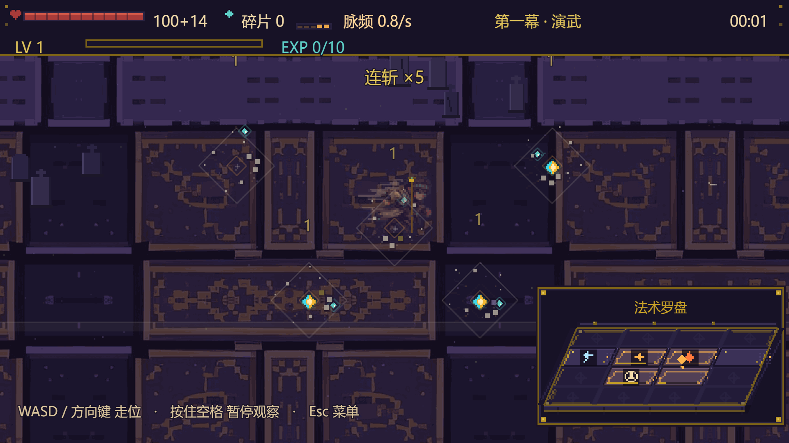
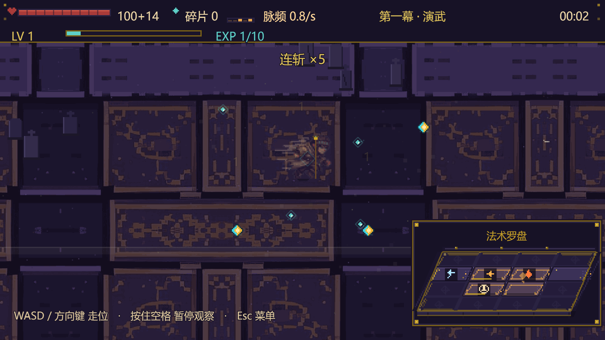
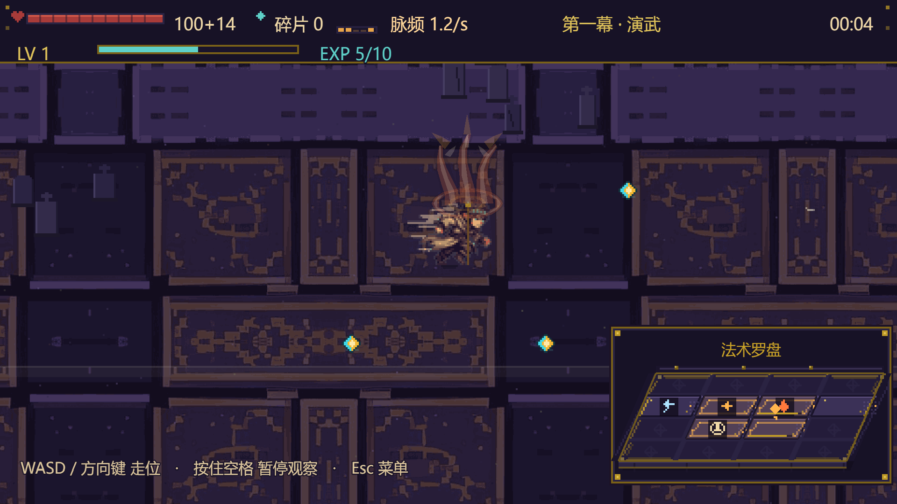

# 击杀爆散与经验粒子（2026-11-10）

> 需求原话：「小怪被打败也要有一个爆散的动画，然后飞出来的粒子代替经验珠」。
>
> 口径：逻辑/单测在本机完成；击杀爆散与经验粒子的完整链路（真实伤害 → 死亡 → 爆散 → 粒子追踪 → 经验入账）在真实 Edge 浏览器里用 `scripts/death-scatter-shot.mjs` 跑过，截图在 [docs/death-scatter](death-scatter)。

## 一、击杀爆散

旧版击杀只有 `effects.killBurst`：一颗白色菱形闪 + 6 枚骨屑，量大时几乎看不出「怪被打开花」。

现在是 `effects.deathScatter`：

| 层 | 表现 |
| --- | --- |
| 首帧白闪（~70ms） | 亮白菱形 + 四向十字，砸出「被命中」的冲击 |
| 冲击环 | 白色（精英黄铜色）菱形环向外扩散，0.5 秒内淡出 |
| 身体碎片 | 普通 12 块 / 精英 18 块，带初速度向四周抛飞 + 重力下坠，1~3px，颜色取骨白/石色/该怪主色 |
| 骨屑尘 | 贴地外扩的低透明度像素，收住尾韵 |
| 确定性 | 方向/速度/大小全部由击杀坐标推导，不用 Math.random；同一次击杀重播一致，截图可复现 |

性能：每个爆散约 30 条绘制指令，0.56s（精英 0.76s）后自动过期；同屏连续击杀也不会靠粒子系统堆对象。

## 二、经验粒子（替代经验珠）

**行为改动：击杀经验不再瞬间入账，而是变成从爆散中心飞出的青色粒子，被玩家吸收后才加经验。**

- 每 1 点经验 = 1 颗粒子：普通杂兵 1 颗、精英 6 颗（与原来的 1/6 点完全一致；经验倍率仍在每颗入账时乘算）。
- 粒子先向外炸散 260ms（带阻尼、轻微重力、拖尾），然后从**任意距离**加速追玩家，速度上限 260px/s；进入 11px 拾取半径即被吸收。
- 吸收时：`grantExp` → 经验条上涨（近处约 0.3s、远处最晚约 1.5s 的可见延迟，读作「捡到了」）→ 青色小环 + 高音反馈；升级仍按原逻辑排队三选一。
- 不会丢经验：池满（320）时直接入账兜底；通幕瞬间调用 `flushExpMotes()` 把还在飞的全部结算；每 20 秒的时间保底经验保持瞬间入账。
- 和碎晶（符文碎片）区分：碎晶仍是 10px 青色符文碎片、需要走近拾取；经验粒子是 2~3px 高速追人的小光点，两者不再混淆。
- Boss 奖励与碎晶经济不变；Boss 不进 `onEnemyKilled` 的经验粒子路径。

## 三、真实浏览器验收

```bash
npm run build
npx vite preview --port 4173 --strictPort
node scripts/death-scatter-shot.mjs
```

一次同帧击杀 5 只杂兵（真实走 `applySigil` → 伤害 → 死亡 → 奖励）：

| 采样点 | 结果 |
| --- | --- |
| 击杀后立刻 | `deathScatter` 特效 5 个、经验粒子 5 颗、EXP 仍为 0（**延迟入账**成立） |
| +2.2s | 经验粒子 0 颗、EXP = 5、等级 1（未误升级） |
| 全程 | 0 个 pageerror |

截图（1920×1080，真实 Phaser 渲染）：

- 
- 
- 

## 四、验证结果

| 项 | 结果 |
| --- | --- |
| 全量单测 | **46 文件 932 项通过**（新增 tests/exp-mote.test.js：粒子轨迹/确定性/拾取/池化复用/爆散预算与过期） |
| 生产构建 | vite build 通过（70 modules，1.55MB / gzip 438KB） |
| 真实浏览器 | 5 杀 → 5 爆散 + 5 粒子；击杀瞬间 EXP 0，2.2s 后 EXP 5、粒子归零、0 pageerror |
| 未做 | 人类试玩手感（碎片数量/粒子速度/是否想要经验数字飘字）仍需你上手定 |

## 五、涉及文件

- src/entities/ExpMote.js：新增经验粒子实体（炸散 → 追踪 → 拾取、池化复用、确定性轨迹）
- src/ui/EffectsLayer.js：deathScatter / drawDeathScatter / expPop / drawExpPop
- src/scenes/BattleScene.js：expMotePool、spawnExpMote / collectExpMote / updateExpMotes / flushExpMotes；onEnemyKilled 改为爆散 + 经验粒子；通幕结算与清理
- src/audio/Sfx.js：exp 吸收音（40ms 节流）
- tests/exp-mote.test.js、scripts/death-scatter-shot.mjs
