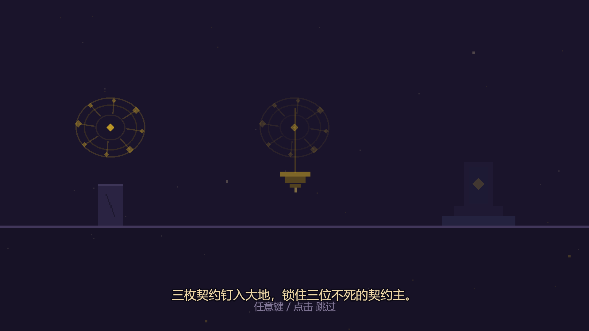
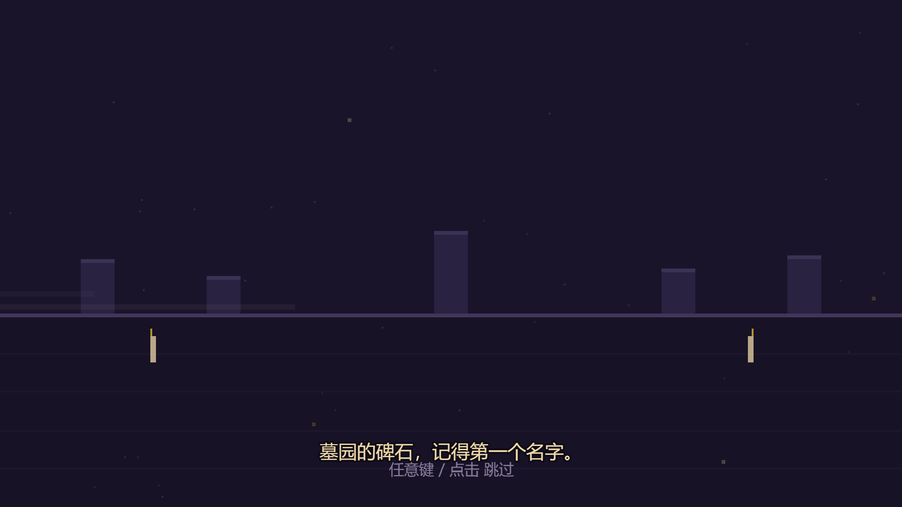
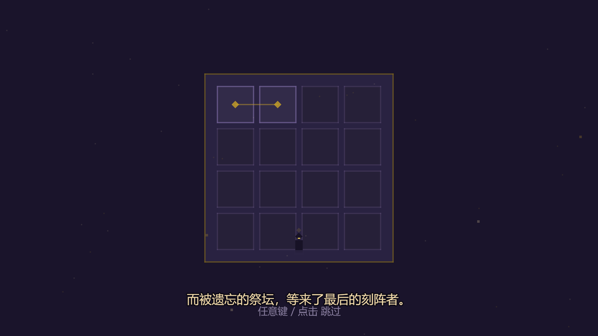
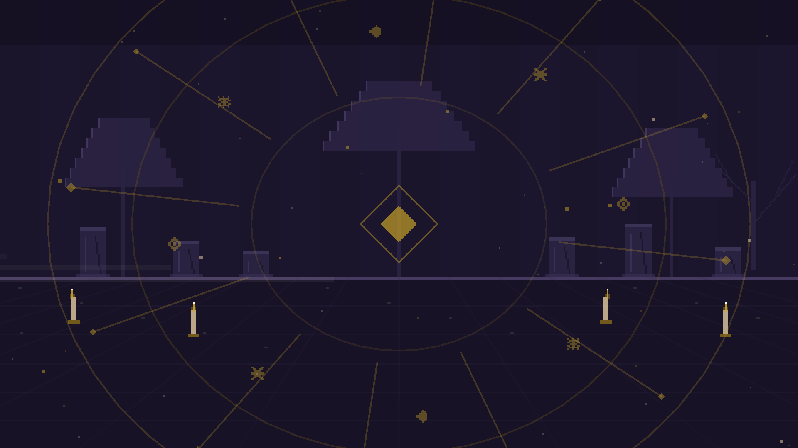
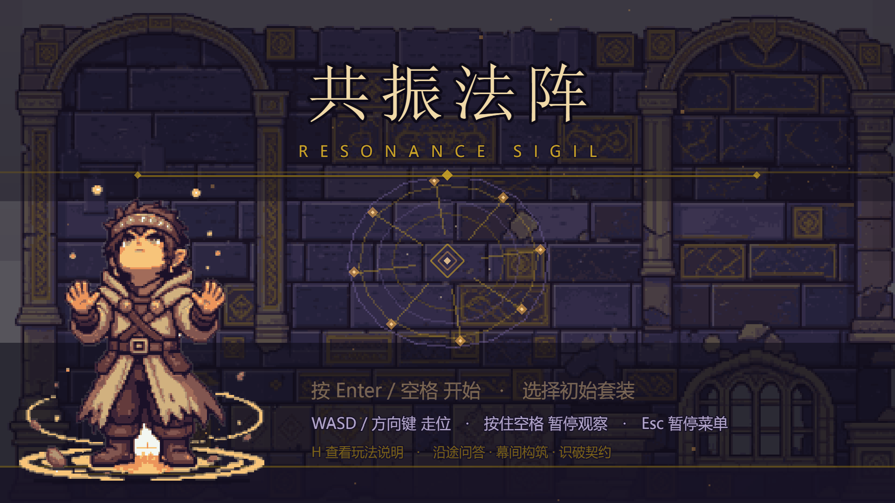
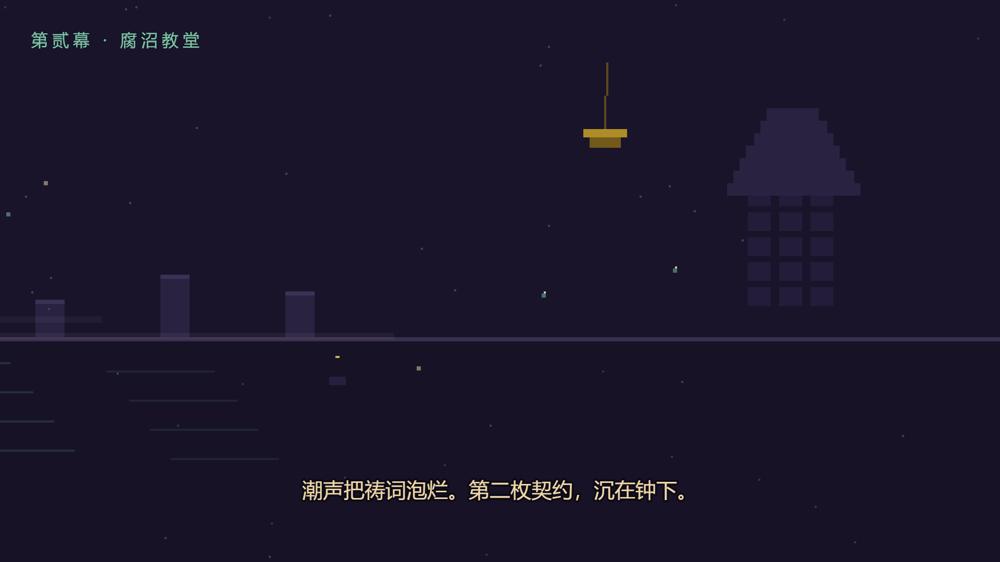
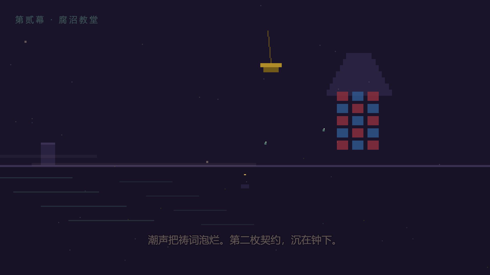
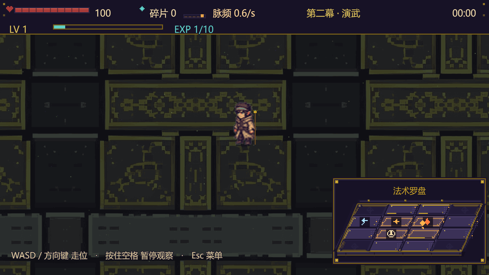
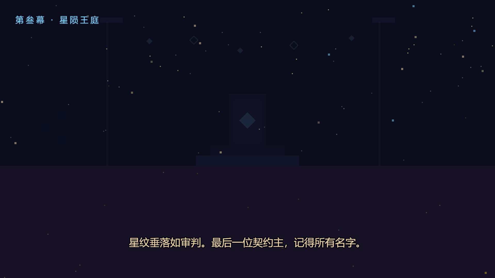
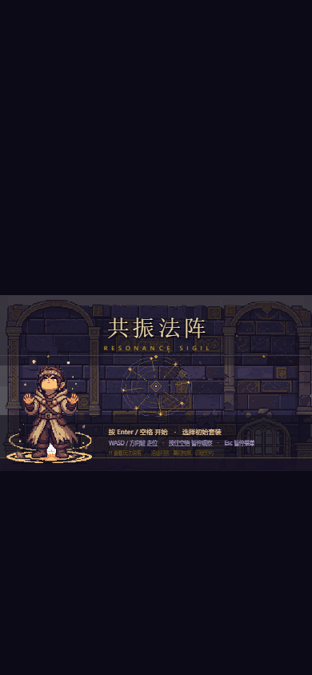

# 开场动画与幕间 journey · 分镜、接入与验收

> 规格：[2026-11-07-cinematic-opening-design.md](superpowers/specs/2026-11-07-cinematic-opening-design.md)（用户逐节批准）。
> 前置基础：[过场动画.md](过场动画.md) 的短过场系统（Cover→Swap→Freeze→Reveal）。
> 本文只加不拆：现有 10 条短过场路径的行为一行不改；第一幕入场保持 1460ms `act` 标题卡。

## 一、分镜表（引用规格第二节，已批准文案）

### 开场（StoryScene，6 镜，总 36000ms）

| # | id | 时长 | 画面 | 字幕 |
| --- | --- | --- | --- | --- |
| 1 | skyfall | 6000ms | 夜空星点闪烁，陨星划痕斜坠，镜头缓下摇，地平线浮出墓园剪影 | 星陨之年，天外的火在王庭熄灭。 |
| 2 | contracts | 6000ms | 三个小舞台依次亮起：墓碑、沉钟、王座，各有契约符环钉入点亮 | 三枚契约钉入大地，锁住三位不死的契约主。 |
| 3 | graveyard | 6000ms | 荒废墓园全景，雾带烛火，镜头缓推中央墓碑，碑面符环微光渐亮 | 墓园的碑石，记得第一个名字。 |
| 4 | altar | 7000ms | 俯视祭坛 4×4 刻格，主角剪影走近立定，刻线逐格亮起，脉流沿格线流动 | 而被遗忘的祭坛，等来了最后的刻阵者。 |
| 5 | awaken | 6000ms | 符环扩张旋转，八枚符文绕环点亮，浮尘上升，中央菱形核心耀亮 | 以脉流为笔，以法阵为刃——替沉默者，补完未竟的仪式。 |
| 6 | title | 5000ms | 符环收拢成一点，「共振法阵」标题浮现；结尾接 `playCutscene(kind:'boot')` 揭开标题页 | （无字幕，音乐收尾） |

镜头 5/6 的符环与 boot 过场符环同源（同一 `drawSeal`），视觉连续不断片。150ms 宽限后任意键/点击跳过整段。

### 幕间 journey（CutsceneScene，各 5840ms：cover 320 / hold 5200 / reveal 320）

| 触发 | 画面 | 字幕 | 角标 |
| --- | --- | --- | --- |
| 幕间 → 第二幕 | 横移长镜头：主角剪影走出墓碑群，雾带沼水渐起，远处教堂彩窗逐格亮灯、吊钟轻摆 | 潮声把祷词泡烂。第二枚契约，沉在钟下。 | 第贰幕 · 腐沼教堂 |
| 幕间 → 第三幕 | 教堂彩窗在身后暗灭，镜头上摇，星纹垂落、浮空碎星升起，王庭立柱与王座浮现 | 星纹垂落如审判。最后一位契约主，记得所有名字。 | 第叁幕 · 星陨王庭 |

## 二、代码结构

    src/data/story.js          分镜纯数据 + buildOpeningTimeline()/shotAt()（无 Phaser，可单测）
    src/ui/story-art.js        每镜一个纯绘制函数 + 两段 journey 长镜头（每帧 ≤700 条绘制指令）
    src/scenes/StoryScene.js   全屏开场播放器：镜头推进/字幕淡入淡出/跳过/结尾接 boot 过场
    src/audio/CineMusic.js     程序化配乐：双正弦 detune 低音铺底 + 镜头 cue，主增益 ≤0.02
    src/data/cinematics.js     TIMELINES 加 journey（320/5200/320）；buildCard('journey') 为 null
    src/scenes/CutsceneScene.js hold 阶段 kind==='journey' 走 journey 绘制；换场机制不改
    src/main.js                StoryScene 注册在 CutsceneScene 之前（覆盖层仍排最后）

数据流：`Boot → StoryScene → playCutscene(boot) → TitleScene`；`Intermission 出发 → playCutscene(journey, act:2|3) → BattleScene`。
调试开关：`?cine=0` / `?stress=1` 开场与过场全关直达标题；`?scene=battle|gameover` 不播开场保持调试直达；`window.__SIGILWEAVE_STORY__` 发布开场状态供验收断言。

## 三、真实浏览器验收（已执行）

2026-11-07 在真实 Edge（Playwright 1.64.1 `channel:'msedge'`，Node v24.19.0，Windows）跑通，1920×1080 桌面 + 390×844 竖屏两档。**14 张截图、11 项 check 全过、0 个 pageerror**；逐项断言在 [verify.json](story/verify.json)（`ok: true`）。

本轮为修复后重跑：首轮验收发现 `CutsceneScene.swapScenes` 不停已暂停（PAUSED）的源场景，StoryScene 冻帧盖住标题页与后续画面；已由提交 `fdebbef` 修复（`isActive(from) || isPaused(from)` 才 stop），本轮逐张目检确认标题页、第二幕战斗、竖屏标题均正常显示，不再被冻帧覆盖。

### check 列表（摘自 verify.json）

| check | 结果 | detail |
| --- | --- | --- |
| 开场总时长 36000ms | ✅ | 36000 |
| boot 停留时标题页已在底下创建并冻结 | ✅ | `{"titleStatus":6,"cutActive":true}` |
| 开场跳过后仍落到标题页 | ✅ | — |
| 第一幕仍是 act 标题卡 | ✅ | kind:act, act:1, duration:1460 |
| journey 属于第 2 幕且时长 5840ms | ✅ | kind:journey, act:2, duration:5840, targetReady:true |
| journey 演出期间战斗已在底下冻结 | ✅ | status 6（PAUSED） |
| 揭开后战斗正常运行 | ✅ | status 5（RUNNING） |
| 第二段 journey 属于第 3 幕 | ✅ | act 3 |
| journey 跳过后战斗正常运行（不软锁） | ✅ | status 5 |
| ?cine=0 开场不播 | ✅ | `__SIGILWEAVE_STORY__ == null` |
| 0 个 pageerror | ✅ | 空 |

### 截图（docs/story/）

| 1 星陨 | 2 三枚契约 | 3 墓园 |
| --- | --- | --- |
|  |  |  |

| 4 祭坛 | 5 觉醒 | 6 标题镜 |
| --- | --- | --- |
|  |  |  |

| boot 交接（标题页已在底下冻结） | 揭开后的标题页 | 第二幕 journey |
| --- | --- | --- |
|  |  |  |

| journey 揭开瞬间 | 第二幕战斗（正常运行） | 第三幕 journey |
| --- | --- | --- |
|  |  |  |

| 竖屏开场首镜 | 竖屏标题页 |
| --- | --- |
|  |  |

### 无缝的硬证据

boot 过场停留时脚本直接读标题页状态：`{"titleStatus":6,"cutActive":true}`——TitleScene 已 `create` 完成、在覆盖层底下 PAUSED 冻结待命，揭开才放行。journey 演出期间同样读到 `battleStatus: 6`，揭开后 `5`；`09b-journey-act2-reveal.png` 可见覆盖层淡出与底下战斗同帧衔接，无黑场。

## 四、复跑

```bash
npm run build
node scripts/static-server.mjs dist 4174   # 后台起
BASE_URL=http://127.0.0.1:4174 node scripts/story-shot.mjs
npx vitest run                              # 38 文件 / 846 项全绿
```

> 受限沙箱里 Playwright 若在系统临时目录 `EPERM`：先确认 `.tmp` 被 git 忽略，再以 `TEMP=$PWD/.tmp/pw-temp TMP=$PWD/.tmp/pw-temp` 前缀重跑。本轮未遇到。

## 五、已知限制

- **首屏无用户手势时配乐静音**：浏览器自动播放策略使 AudioContext 处于 suspended，开场静音播放，首次点击/按键后激活；这是平台限制，不算缺陷（规格第五节已写明）。静音开关（M 键/菜单）对配乐同样生效。
- 开场每次刷新都播（用户既定决策，不做"仅首次"存档标记）；可用 `?cine=0` 关闭。
- 截图为固定种子（`?seed=story-shot` 等）下的确定性画面；粒子位置随种子变化，构图不变。