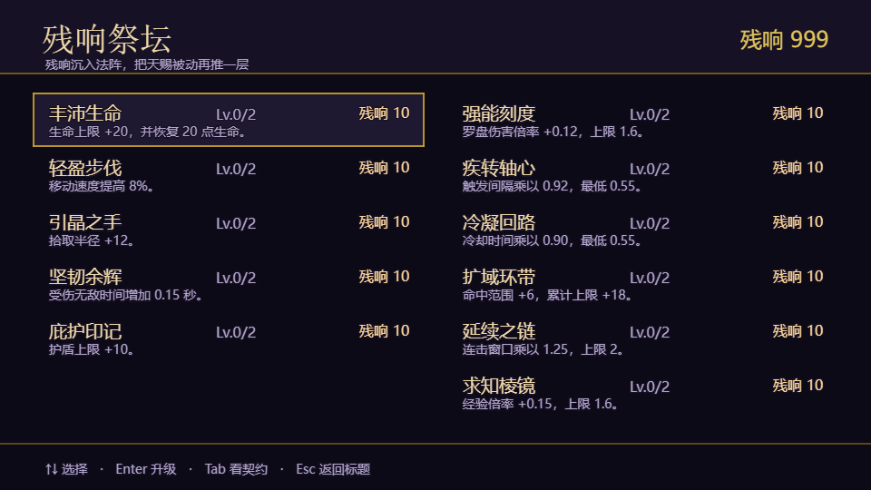
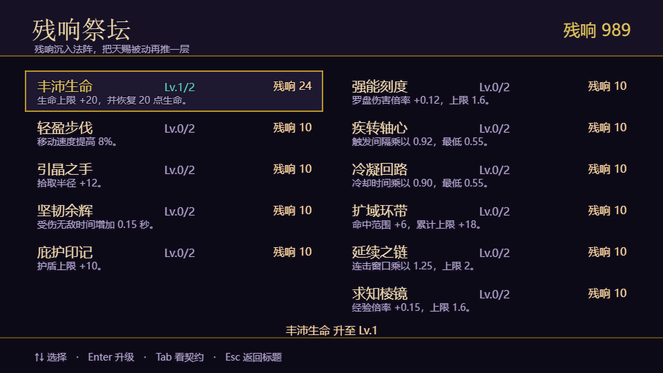
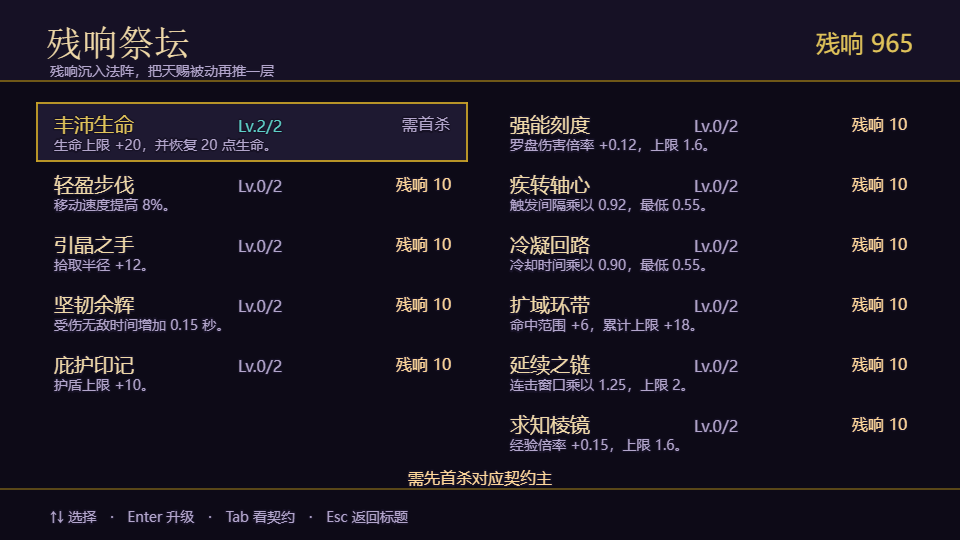
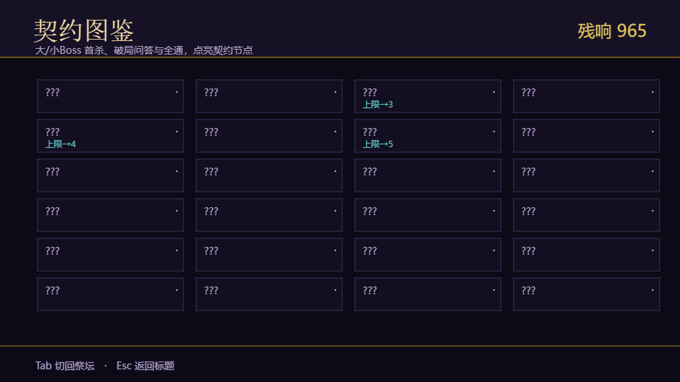

# 残响祭坛

> 局外成长只有一处：标题页按 B 进入的残响祭坛。一局结束把战果折成残响，残响换成 11 条天赐被动，首杀与通关再点亮 34 个契约节点。
> 这一页不改变局内规则，只把「下一局开局更强、上限更高」这件事做出来。数值口径以[规则契约](<规则契约.md>)为准。

## 一、入口与操作

| 入口 | 说明 |
| --- | --- |
| 标题页按 B | 进祭坛；玩法说明面板开着时 B 不抢键 |
| 地址加 `?scene=meta` | 直接落到祭坛，便于截图与冒烟 |
| 结算页 → 回标题 | 再次按 B，余额与等级都在 |

| 键 | 作用 |
| --- | --- |
| `↑` `↓` / `W` `S` | 列内移动，到列尾自动翻到另一列 |
| `←` `→` / `A` `D` | 直接跳到另一列 |
| `Enter` / `Space` | 升级选中的被动 |
| `Tab` | 在「残响祭坛」与「契约图鉴」两页间切换 |
| `Esc` | 回标题 |

两页页眉右上角都显示「残响 N」。被动页底部一行常驻操作提示；升级成功显示「XX 升至 Lv.N」，失败按原因显示「残响不足」「需先首杀对应契约主」「已达满级」。导航有 70ms 去抖，按住方向键不会一次跳两格。






截图由 `node scripts/meta-smoke.mjs` 在 960×540 视口实拍。

## 二、残响怎么算

一局结束（死亡或通关）时结算一次，写进局外档。全部系数来自 `src/data/meta.js` 的 `SETTLE`：

| 项 | 公式 | 说明 |
| --- | --- | --- |
| 幕数 | 幕 × 8 | `actWeight: 8`，幕取 1~5，越界夹住 |
| 击杀 | ⌊击杀 ÷ 40⌋ × 1 | `killStep: 40`、`killPoint: 1`；只算整 40 |
| 小 Boss | 解决数 × 2 | `miniBoss: 2`，答对与实战都算 |
| 大 Boss | 解决数 × 6 | `majorBoss: 6`，只认本场契约主 |
| 问答 | 破局数 × 4 | `quiz: 4`，大 Boss 与小 Boss 的答对次数 |
| 通关 | + 60 | `victory: 60` |
| 死亡 | 合计 × 0.6 | `deathRate: 0.6` |
| `?quick=1` | 再 × 0.5 | `quickRate: 0.5`，与死亡乘算 |

合计最后 `Math.round` 取整，结果不为负（`Math.max(0, …)`）。举两例：

| 情形 | 代入 | 残响 |
| --- | --- | --- |
| 第 3 幕死亡，击杀 120、小 Boss 2、大 Boss 1、问答 1 | (24 + 3 + 4 + 6 + 4) × 0.6 = 24.6 | 25 |
| 第 5 幕通关，击杀 420、小 Boss 6、大 Boss 7、问答 3 | 40 + 10 + 12 + 42 + 12 + 60 = 176 | 176 |

不结算的情形：中途关页或刷新（没有局内存档）、`?stress=1` 压测、`?scene=gameover` 调试跳转、演武未完成。结算页第九行写「残响 +N ／ 残响累计 M」，`M` 是加完后的余额。

首杀与通关还会另发一笔里程碑奖励，直接并进余额：新余额 = 原余额 + 本局 gained + 新点亮节点的 reward 之和。

## 三、11 条被动，各 5 级

两列固定：左列 5 条人物被动（宝箱开出），右列 6 条罗盘被动（大 Boss 战利品）。价格表 `LEVEL_COSTS = [10, 24, 48, 80, 120]`，买第 1 级花 10、第 2 级花 24，依次到第 5 级 120，满级合计 282。

| 列 | 名称 | 基础效果 | 每级追加 | 五级合计 |
| --- | --- | --- | --- | --- |
| 人物 | 丰沛生命 `life` | 生命上限 +20，并当场回 20 | 上限 +2、回复 +2 | 上限 +30 ／ 回复 +30 |
| 人物 | 轻盈步伐 `swift` | 移速 ×1.08 | ×(1 + 0.008·lv) | ×1.123 |
| 人物 | 引晶之手 `magnet` | 拾取半径 +12 | +1.5 | +19.5 |
| 人物 | 坚韧余辉 `tough` | 受击无敌 +0.15s | +0.02s | +0.25s |
| 人物 | 庇护印记 `aegis` | 开局护盾 +10 | +1.5 | +17.5 |
| 罗盘 | 强能刻度 `might` | 伤害 +0.12（上限 1.6） | +0.015 | +0.195 |
| 罗盘 | 疾转轴心 `haste` | 符印间隔 ×0.92（下限 0.55） | ×(1 − 0.006·lv) | ×0.892 |
| 罗盘 | 冷凝回路 `chill` | 符印冷却 ×0.90（下限 0.55） | ×(1 − 0.006·lv) | ×0.873 |
| 罗盘 | 扩域环带 `wide` | 施法范围 +6（上限 +18） | +0.8 | +10 |
| 罗盘 | 延续之链 `chain` | 联组窗口 ×1.25（上限 2） | ×(1 + 0.04·lv) | ×1.5 |
| 罗盘 | 求知棱镜 `greed` | 经验 +0.15（上限 1.6） | +0.02 | +0.25 |

**等级上限默认 2 级**，不是一上来就能点满。上限由契约节点解锁：首杀 `boss-3` 抬到 3 级，`boss-5` 抬到 4 级，`boss-7` 抬到 5 级。被上限挡住时价格位置显示「需首杀」，不是「残响 N」。已满级的行显示「已满级」。

判定顺序固定：先看是否满级 → 再看是否够上限 → 最后看残响。所以买不起和被上限拦两种失败给的提示不同，试玩时可以直接靠提示判断卡在哪一层。升级成功后写档并刷新 `updatedAt`；失败不扣残响。

## 四、34 个契约节点

图鉴把「打过什么」变成永久记录，也顺便当进度表。共 34 格，6 列排布：

| 类别 | 数量 | 单节点奖励 | 小计 | 点亮条件 |
| --- | --- | --- | --- | --- |
| 契约主 | 7 | 25 | 175 | 解决该场大 Boss（答对或实战） |
| 小契约 | 20 | 8 | 160 | 解决该场任一具名小 Boss |
| 通关 | 5 | 30 | 150 | 走完对应幕 |
| 破局者 | 1 | 60 | 60 | 单局问答击破 5 次 |
| 清扫者 | 1 | 40 | 40 | 单局击杀 300 |
| 合计 | 34 | — | 585 | — |

未点亮的格子只显示 `???`；点亮后显示名称与「+奖励」。七个契约主里有三个同时是上限节点，格子里额外写「上限→3/4/5」。死亡时「通关」类只记已经走完的幕，当前幕不算。

## 五、存档与坏档收敛

| 项 | 值 |
| --- | --- |
| 存储键 | `sigilweave:meta:v1` |
| 存什么 | 残响余额、11 条被动等级、已点亮节点、统计（局数、通关数、问答击破、最佳幕、最高击杀）、`updatedAt` |
| 存在哪 | 浏览器 `localStorage`；桌面版在应用数据目录；隐私模式下退回进程内内存，关页即失 |
| 读档 | 每次进祭坛与结算先读，逐项收敛后再用 |
| 写档 | 只有升级成功、结算发放、`?resonance=` 三种情况写 |

坏档一律**收敛而不是报错**：字符串先 `JSON.parse`，失败就用默认档；不是对象、是数组、字段类型不对，逐项夹回合法值。残响只收非负安全整数；等级逐条夹 0~5；节点只留字符串、必须在 34 条名单内并且去重；统计里的幕夹 1~5。所以手改坏 `localStorage` 最多让进度清零，不会白屏。

另外两点容易踩：`?resonance=999` 是**写真实存档**的调试口，验完记得清；游戏没有局内存档，中途关页那一局的残响不会补发。

## 六、怎么复现这一页

```bash
node scripts/meta-smoke.mjs
BASE_URL=http://127.0.0.1:4174 CDP_URL=http://127.0.0.1:9333 node scripts/meta-cdp-check.mjs
```

前者用 Playwright 起 Edge 断言余额 999、初始 0 级并出四张截图；后者走原生 CDP，断言「升一级扣 10 → 撞上限提示 → 图鉴 0 解锁 → 结算页残响行」，通过时打印 `META_CDP_OK`。逻辑与 UI 的单测在 `tests/meta-*.test.js`。

## 相关文档

- [规则契约](<规则契约.md>) —— 被动效果的生效顺序与上下限口径。
- [五幕七场](<五幕七场.md>) —— 幕场映射与 34 条遭遇，节点点亮条件按它结算。
- [交付说明](<交付说明.md>) —— 整体交付范围、验收命令与已知限制。
- [试玩清单](<试玩清单.md>) —— 祭坛与存档两节的逐条检查项。

## 历史

- 功能落地过程与首版截图记录见[迭代记录总览](<迭代记录总览.md>)、[大地图验收记录](<大地图验收记录.md>)。
