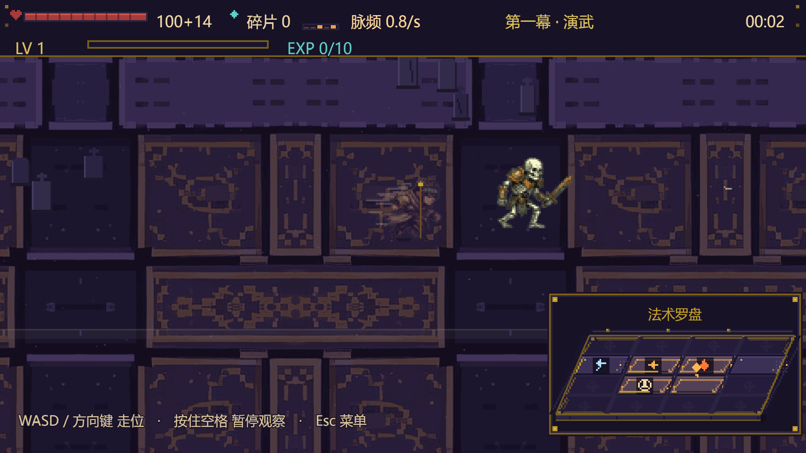
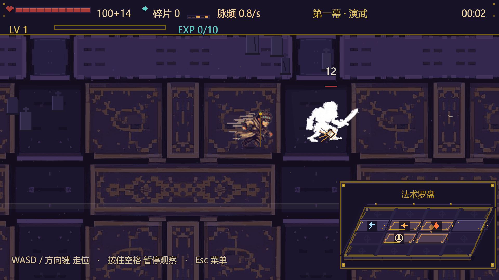
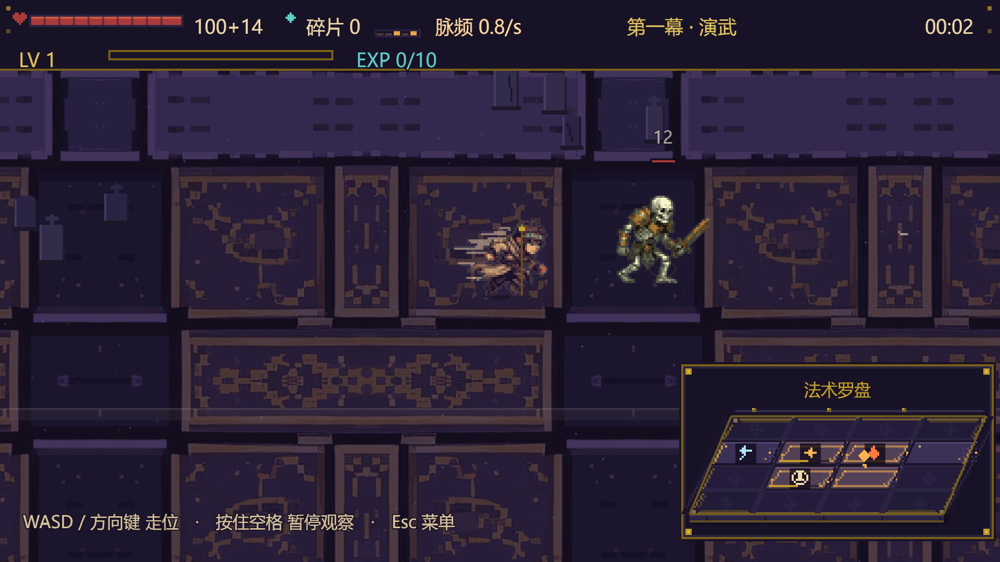
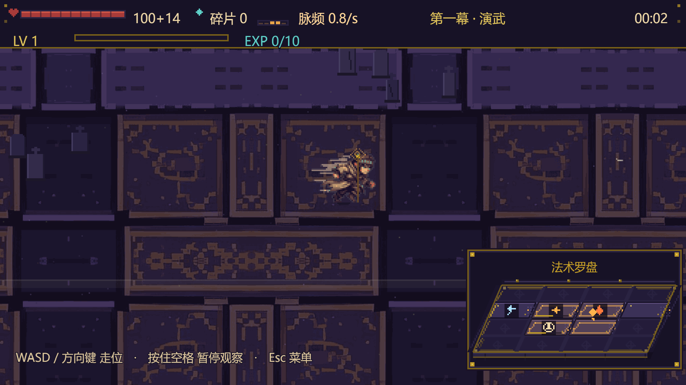

# 索敌改为「只打屏幕内」+ 小怪受击细节（2026-11-09）

> 本轮两条用户需求：
> 1. 「锁定算法有问题，要等小怪进入屏幕内再攻击，不要攻击屏幕外的小怪」；
> 2. 「给游戏的小怪增加受击细节动画」。
>
> 口径：逻辑与单测在本机完成；两项改动都在**真实 Edge 浏览器**里用 `targeting-smoke.mjs` / `hit-fx-shot.mjs` 跑过，截图见 [targeting-hit](targeting-hit)。

## 一、索敌：屏幕是唯一判定标准

### 改前的问题

`src/logic/sector.js` 上一版为了让「打不着远处的怪」不再发生，把 16 个方位条带铺满**整张世界地图**：
内 2×2 是屏幕，外 12 条全在屏幕外。于是：

- 边角格（如 4 / 7 / 9 号位）对应的是「屏外条带」，会直接锁定 300~500px 外的怪；
- 本区没有怪时走「空区补射」，补射候选是**全世界**最近的怪，包括完全没进屏的；
- 法术飞出去半天才打到屏幕上根本看不见的目标，玩家体感就是「在打屏幕外的小怪」。

### 改后的规则

| 规则 | 实现 |
| --- | --- |
| 「屏幕内」以摄像机视口为准 | `BattleScene.viewRect()` 读 `cameras.main.worldView`，已包含 zoom、竖屏镜头偏移（+190）、跟随死区，不再用玩家坐标硬算 480×270 |
| 身体露出来就算进屏 | `sector.enemyScreenRect()` 优先用敌人视觉外框 `viewExtent`（精灵高 56px，脚在逻辑点、身体向上长）；没有素材时退回逻辑半径 + 身体高度估算 |
| 屏外一律不锁 | `resolveTarget` / `resolveVolley` 新增 `options.view`：本区候选与「空区补射」都先过滤视口 |
| 屏幕内清空就停火等待 | `BattleScene` 在齐射目标为 0 时**不发射弹丸、不画朝屏外的光迹**，只闪罗盘格 + 画一圈杖尖待机环；等怪进屏后下一次触发立刻出手 |
| 伤害结算同步收紧 | `resolveSigilTrigger` 的所有命中集合（单体落点 / 扇形 / 扩散 / 贯穿走廊 / 连锁跳跃 / 护盾 / 回声 / 区域）都过视口；`resolveDeathBursts` 的尸爆连锁、`resolveComboBonus` 的联组追加同样只结算屏内目标 |
| 飞行中目标出屏 | `BattleScene.updateProjectiles` 每帧检查：目标出屏就停止追踪，落点停在它最后所在的屏内位置，不在屏外结算 |
| 纯逻辑调用兼容 | 不传 `view` 时保持旧行为（无过滤），既有契约测试不被破坏；战斗场景始终传 `view` |

护盾类（`ward`）是自身增益，不依赖敌方目标，仍然照常释放。

### 浏览器回归（真实 Edge，非模拟）

```bash
npm run build
npx vite preview --port 4173 --strictPort
node scripts/targeting-smoke.mjs
```

关键输出（2026-11-09 22:11 实跑）：

- 屏幕内清空后 3.8 秒：`fired = 0`，`triggers = 4` —— 引擎在触发、但一发弹丸都没放（停火等待）。
- 屏内 3 只靶子：血量 9999 → 9985 / 9981 / 9998，全部 `hitPower > 0`。
- 屏外 3 只靶子：血量全部保持 9999，`hurt = false`。
- 26 只同屏压测：最近间距 20px（不叠怪）。
- 0 个 pageerror。

## 二、小怪受击细节动画

只改表现，不动逻辑坐标（x/y 不参与后坐），所以碰撞、索敌、命中判定、死亡结算都不受影响。

| 细节 | 做法 |
| --- | --- |
| 闪白 → 残红 → 常态 | 前 120ms 闪白强度线性衰减；精灵用 setTintFill(白) → setTint(红) → 残红 → 原本状态色，程序化回退用白色覆盖层按强度渐隐 |
| 后坐 | 沿「命中来向」弹一下再回位，220ms 衰减；伤害占比越高力度越大（0.3~1），重击最多约 5.5px 位移 |
| 受击抖动 | 垂直命中方向的正弦抖动（1.3px 内），按受击序号相位错开，同屏几十只不会同频共振 |
| 精灵挤压 + 倾斜 | 受击时以脚底为原点横向鼓、纵向压（最大 ±18%），并沿受力方向轻微倾斜（0.12rad），比单帧白闪更「打实了」 |
| 定向火花 | 新增 effects.hitSpark：白核 + 沿命中反方向喷 4 条火星 + 扩散冲击环，寿命 220ms；沿用法术主色 |
| 伤害数字 | 新增 effects.damageNumber：头顶上浮 620ms，重击（单次伤害 ≥ 28% 最大生命）用黄铜色并放大一号；只在单次命中 ≤3 个目标时显示，避免范围法术糊满屏 |
| 血条延迟白条 | 受伤后白色残条先停在受伤前位置，220ms 后快速回落（hpChip）；法术 / 尸爆走 applyDamage 也能自动触发，不依赖 takeDamage |
| 程序化回退 | 没有素材时同样有后坐、抖动、闪白渐隐与延迟血条；viewExtent 也照常可用 |

截图（1920×1080，真实 Phaser 渲染）：

- 
- 
- 
- 

复跑：

```bash
node scripts/hit-fx-shot.mjs   # 需要 preview 服务在 4173
```

## 三、验证结果

| 项 | 结果 |
| --- | --- |
| 全量单测 | **45 文件 924 项通过**（新增 tests/screen-targeting.test.js、tests/hit-feedback.test.js） |
| 生产构建 | vite build 通过（69 modules，1.55MB / gzip 437KB） |
| 真实浏览器索敌回归 | 屏内 3/3 掉血、屏外 3/3 满血、空场 0 弹丸、0 pageerror |
| 真实浏览器受击截图 | 4 张，见上 |
| 未做 | 人类试玩手感（「够不够明显/会不会太吵」仍需你上手定） |

## 四、涉及文件

- src/logic/sector.js：视口过滤（normalizeView / enemyScreenRect / isEnemyOnScreen / visibleFilter），resolveTarget / resolveVolley 接入
- src/logic/effects.js：resolveSigilTrigger / resolveDeathBursts / resolveComboBonus 视口过滤；applyDamage 记录 lastHitAmount
- src/scenes/BattleScene.js：viewRect()、空场停火、命中反馈 onEnemyHit、弹丸出屏停止追踪
- src/entities/Enemy.js：hitReact / hitOffset / viewExtent / hpChip 延迟血条 / 闪白与挤压
- src/ui/EffectsLayer.js：hold / hitSpark / damageNumber
- tests/screen-targeting.test.js、tests/hit-feedback.test.js、scripts/targeting-smoke.mjs、scripts/hit-fx-shot.mjs
