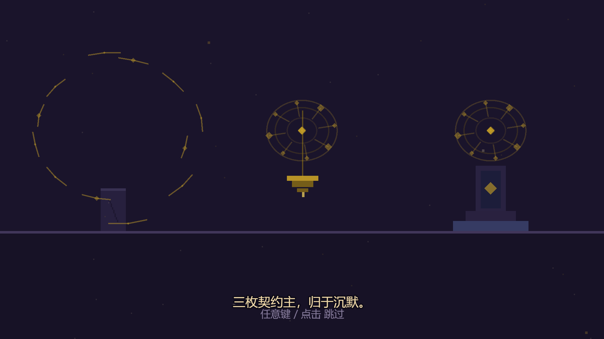
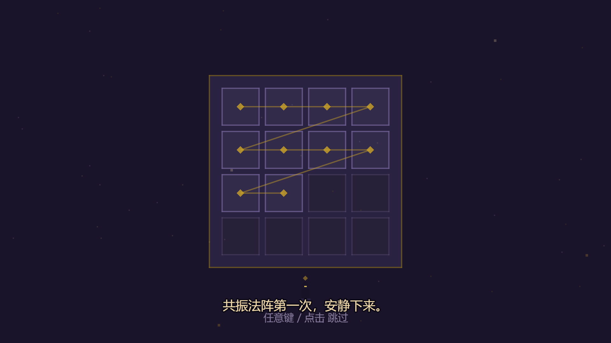
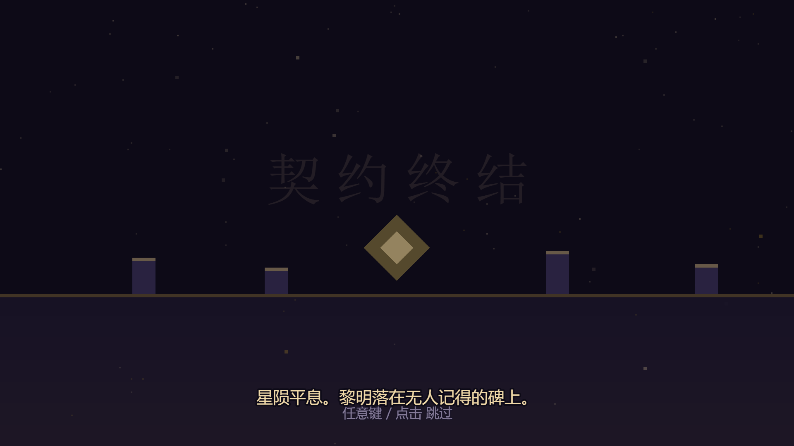
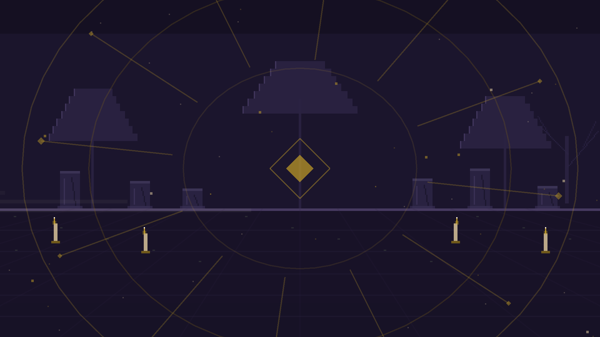
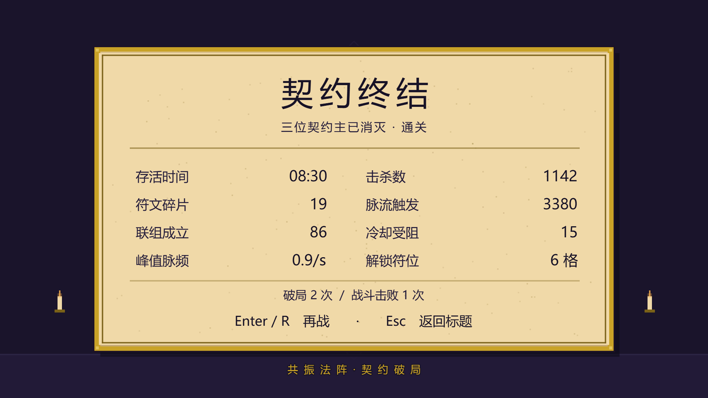
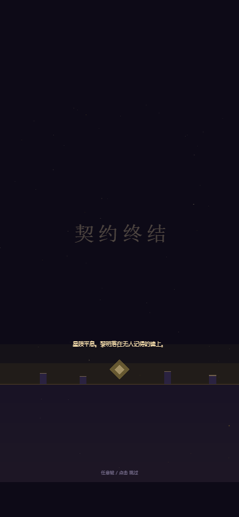
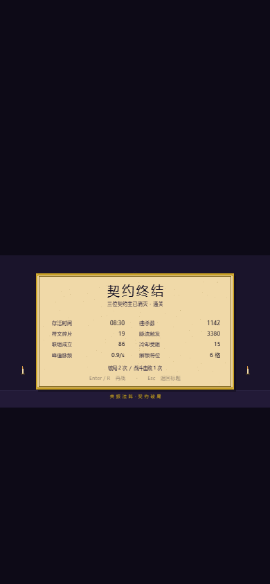

# 结局演出与演职员 · 分镜、接入与验收

> 规格：[2026-11-08-cinematic-ending-bold-design.md](superpowers/specs/2026-11-08-cinematic-ending-bold-design.md)（用户批准）。
> 前置基础：[过场动画.md](过场动画.md) 的短过场系统 + [开场与幕间.md](开场与幕间.md) 的分镜播放器。
> 本文只加不拆：换场状态机一行不改；开场六镜与两段 journey 一行不改；胜利结算面板零改动。

## 一、分镜表（StoryScene ending 模式，4 镜总 32000ms）

| # | id | 时长 | 画面 | 字幕 / cue |
| --- | --- | --- | --- | --- |
| 1 | release | 7000ms | 与开场「三契钉入」同一组圣物，三枚符环依次碎裂，圣物逐次暗成墨色 | 三枚契约主，归于沉默。/ bell |
| 2 | quiet | 7000ms | 祭坛刻格逆向逐格熄灭，脉流断绝，刻阵者立定，魂火 gutter 后熄灭 | 共振法阵第一次，安静下来。/ hush |
| 3 | dawn | 8000ms | 星点淡出、陨星停息，硬边黄铜黎明色带升起，低日浮出；「契约终结」标题淡入 | 星陨平息。黎明落在无人记得的碑上。/ arp |
| 4 | credits | 10000ms | 夜空 + 暗符环缓转，名单三行硬边带状滚动 | （无字幕）/ finale |

名单（不署个人名）：`共 振 法 阵` → `设计 · 程序 · 像素美术 · 程序化音乐` → `感谢每一位刻阵者`。

数据流：`completeAct 第三幕 → playCutscene(victory → StoryScene{mode:'ending',stats}) → 32s → playCutscene(boot → GameOverScene, stats 原样) → 胜利面板`。`?cine=0`/`?stress=1` 不播结局直达面板。150ms 宽限后任意键/点击跳过整段。

## 二、代码结构

    src/data/story.js          ENDING_SHOTS + buildEndingTimeline() + STORY_MODES（音乐/发布键/交接）
    src/scenes/StoryScene.js   双模式分镜播放器；结局推迟配乐到首次 update；名单 Text 滚动；handoff 待重试
    src/ui/story-art.js        ENDING_STAGES 四镜（release/quiet/dawn/credits），与开场共用 drawContractRelic
    src/audio/CineMusic.js     ending 模式（65.4Hz/0.6）+ hush cue
    src/scenes/BattleScene.js  completeAct 第三幕分支改道结局；?cine=0 直达面板

结局发布 `window.__SIGILWEAVE_ENDING__`（开场仍用 `__SIGILWEAVE_STORY__`）。

## 三、真实浏览器验收（已执行）

2026-11-08 真实 Edge（Playwright `channel:'msedge'`），1920×1080 桌面 + 390×844 竖屏。**9 张截图、8 项 check 全过、0 个 pageerror**；逐项断言在 [verify.json](ending/verify.json)（`ok:true`）。

| check | 结果 | detail |
| --- | --- | --- |
| 胜利卡时长仍在 900–1600ms | ✅ | 1600 |
| 胜利卡停留时结局播放器已在底下创建并冻结 | ✅ | `{"storyStatus":6,"cutActive":true}` |
| 结局总时长 32000ms | ✅ | 32000 |
| boot 交接停留时结算面板已在底下创建并冻结 | ✅ | `{"panelStatus":6,"cutActive":true}` |
| 揭开后结算正常运行且为胜利面板、跑分透传 | ✅ | `{"status":5,"victory":true,"kills":1142}` |
| 结局跳过后结算正常运行（不软锁） | ✅ | status 5 |
| ?cine=0 不播结局直达胜利结算 | ✅ | `{"ending":null,"victory":true}` |
| 0 个 pageerror | ✅ | 空 |

### 截图（docs/ending/）

| 胜利卡（编舞版） | 1 三契尽解 | 2 法阵安静 |
| --- | --- | --- |
|  |  |  |

| 3 黎明 | 4 名单 | boot 交接（面板已在底下冻结） |
| --- | --- | --- |
|  |  |  |

| 胜利结算面板 | 竖屏黎明 | 竖屏胜利面板 |
| --- | --- | --- |
|  |  |  |

### 无缝与死锁修复的硬证据

胜利卡停留时读到 `storyStatus:6`（StoryScene 已 create、PAUSED 冻结待命）；boot 交接停留时读到 `panelStatus:6`，揭开后 `5`。

本轮踩到并修掉一条死锁：结局在胜利过场 **reveal 收尾窗口**（`isActive(CutsceneScene)` 仍 true）内被跳过时，`playCutscene` 的「已在过场中」守卫吞掉交接，StoryScene 误以为「过场被禁用」自停 → 无任何活跃场景。探针实证：Enter 落下瞬间 `victory/reveal/elapsed1513`，500ms 后 StoryScene 与 CutsceneScene 均 status 8、GameOverScene 从未启动。修法：`StoryScene.handoff` 区分「被禁用」（自停）与「过场收尾」（标记 `handoffPending`，覆盖层停下后 update 自动重试）。单测回归 + 探针复跑确认 boot 交接正常发起、面板冻结待命。

## 四、复跑

```bash
npm run build
node scripts/static-server.mjs dist 4174   # 后台起
BASE_URL=http://127.0.0.1:4174 node scripts/ending-shot.mjs
npx vitest run                              # 41 文件 / 889 项全绿
```

## 五、已知限制

- 首屏无用户手势时配乐静音（浏览器自动播放策略），首次点击/按键激活；平台限制，不算缺陷。静音开关（M 键）对结局配乐同样生效。
- 结局每次通关都播；可用 `?cine=0` 关闭直达面板。
- 名单不署个人名（品牌+职责+感谢）；如需署名替换 `ENDING_SHOTS` credits 数组。