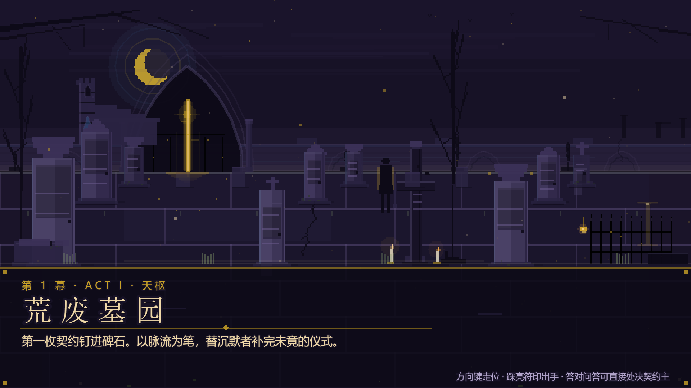
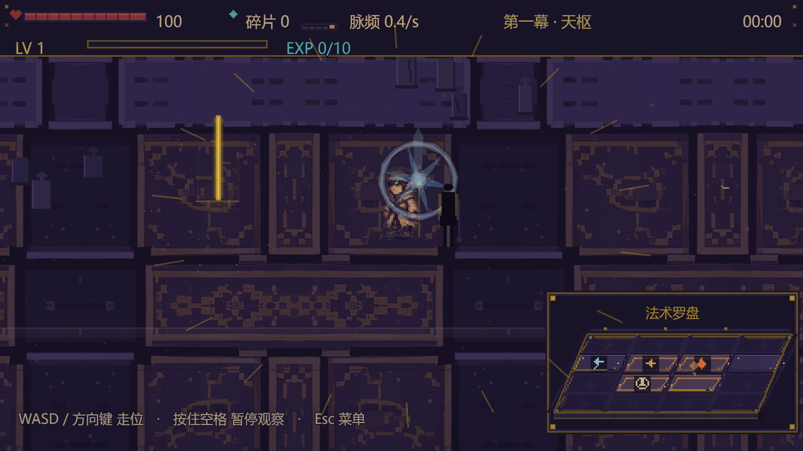
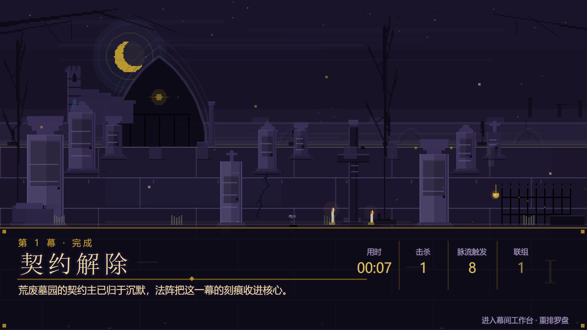
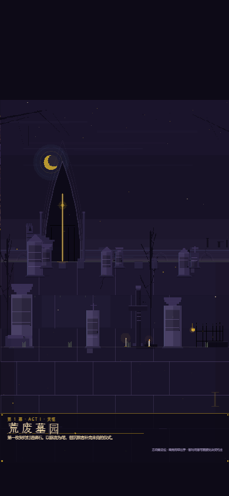

# 过场动画

所有切场统一走 `playCutscene`：盖住旧场景 → 完全盖住时换场 → 目标在覆盖层底下创建并冻结 → 揭开。九类时间轴，十条实际路径。

这份写短过场本身：状态机、时间轴、碑座标题卡、七场三层布景与三拍事件、验收门槛。开场六镜与幕间 journey 见 [开场与幕间.md](<开场与幕间.md>)，结局四镜与演职员见 [结局与演职员.md](<结局与演职员.md>)。

## 一、十条路径

| # | 触发点 | `kind` | 去向 | 总时长 | 画面 |
| --- | --- | --- | --- | --- | --- |
| 1 | 启动（`?cine=0` / `?scene=` 除外） | `boot` | `BootScene` → `TitleScene` | 960ms | 三支烛依次点亮 → 火苗拉成符环 → 环常明 |
| 2 | 标题页进入选套 | `sigil` | `TitleScene` → `LoadoutScene` | 920ms | 契约钉落到石面 → 触石震屏、石屑迸出 → 符环从钉帽外扩 |
| 3 | 选套出战 | `act` | `LoadoutScene` → `BattleScene` | 1460ms | 门缝透出一线光 → 光缝撑开、契约主在门内现身 → 门缝与剪影留在场上，场名逐字砸落 |
| 4 | 一幕打完（非终局） | `clear` | `BattleScene` → `IntermissionScene` | 1420ms | 契约主颤动 → 崩解成灰、契约钉拔起断两截 → 灰堆 + 断钉 + 地面裂纹常留 |
| 5 | 幕间出发 | `journey` | `IntermissionScene` → `BattleScene` | 5840ms | 横移长镜头，逐幕不同（见 [开场与幕间.md](<开场与幕间.md>)） |
| 6 | 战斗中死亡 | `death` | `BattleScene` → `GameOverScene` | 1120ms | 剪影跪倒 → 魂火升起被吹散 → 血纹四段蔓延、两盏烛熄 |
| 7 | 第七场终局 | `victory` | `BattleScene` → `StoryScene`（ending） | 1600ms | 七钉自北斗方位升起 → 向心汇成一枚星炸开 → 七星连线常亮；之后接 32s 结局 |
| 8 | 结算页 / 暂停菜单「再战」 | `retry` | `GameOverScene` / `BattleScene` → `BattleScene` | 920ms | 刻线出现断口 → 刻笔逐段补刻 → 刻线合拢（紧凑卡「再 入 契 约」） |
| 9 | 结算页 / 暂停菜单「回标题」 | `return` | `GameOverScene` / `BattleScene` → `TitleScene` | 920ms | 雾自两侧卷入 → 烛逐盏熄灭 → 只余中央一盏（紧凑卡「祭 坛 暂 歇」） |
| 10 | 开场 / 结局播完交接 | `boot` | `StoryScene` → `TitleScene` / `GameOverScene` | 960ms | 同 1；区别是交接时目标已经在覆盖层底下创建并冻结 |

时间轴在 `TIMELINES`（`src/data/cinematics.js`），`buildTimeline(kind)` 把 `coverMs + holdMs` 算成 `revealAt`、再加 `revealMs` 得 `totalMs`。

| kind | cover | hold | reveal | 合计 |
| --- | --- | --- | --- | --- |
| `boot` | 300 | 360 | 300 | 960 |
| `sigil` | 300 | 320 | 300 | 920 |
| `act` | 320 | 820 | 320 | 1460 |
| `clear` | 320 | 780 | 320 | 1420 |
| `death` | 380 | 440 | 300 | 1120 |
| `victory` | 360 | 900 | 340 | 1600 |
| `retry` | 300 | 320 | 300 | 920 |
| `return` | 300 | 320 | 300 | 920 |
| `journey` | 320 | 5200 | 320 | 5840 |

短过场落在 **920–1600ms**：最短是 `sigil` / `retry` / `return` 920，最长是 `victory` 1600。`journey` 是 5.8 秒级的单独一档。

## 二、状态机

`CutsceneScene` 只认两个量：`elapsed`（每帧夹取 `Math.min(64, delta)`）和 `swapped`/`targetReady`。四个阶段由 `phaseAt(elapsed, timeline)` 切，边界归后一阶段。

1. **盖场**：`create` 时先把源场景 `pause`（仍渲染，不推进）。遮罩从 0 盖到 1，底色是祭坛暗紫叠当幕主题色，**任何时刻都有内容，没有纯黑帧**。
2. **换场**：`elapsed >= coverMs` 时 `swapScenes()`——`stop` 源场景的判定是 `isActive(from) || isPaused(from)`（PAUSED 在真实 Phaser 里 `isActive()` 为 false，只查 `isActive` 会漏停冻结的源场景），再 `launch` 目标并 `bringToTop`。
3. **冻结**：目标派发 `CREATE` 后立刻 `freezeTarget()` 暂停它。所以标题卡停留期间底下已经画好了世界，但没人能走、没人能挨打。
4. **揭开**：`elapsed >= revealAt && targetReady` 才 `resumeTarget()`；目标 1500ms 内没派发 `create` 也强制放行，不会把人锁在覆盖层里。
5. **收尾**：`elapsed >= totalMs` → `finish()`，`publish('done')` 后 `scene.stop()`。

两条不能拆的细节：

- **未就绪不揭开**：`targetReady` 为假时把 `elapsed` 钉在 `revealAt`，保持满覆盖，不露空帧。
- **resume 看门狗**：`SceneManager` 的 `pause/resume` 是排队操作，跳过时 `resume` 可能先于 `pause` 落地导致目标永久暂停。`ensureTargetRunning()` 用与场景生命周期无关的定时器连续补 resume（12 次 × 32ms ≈ 400ms），并带 owner 标记——新过场一开，旧看门狗自动停。

### 跳过语义

任意 `keydown`（忽略 auto-repeat）或 `pointerdown` 触发 `skipResult(elapsed, timeline, swapped)`：

| 条件 | 动作 |
| --- | --- |
| `elapsed < 150ms` | 不响应（`SKIP_GRACE_MS`，防止触发转场的那一下顺带吞掉转场） |
| 还没换场 | 立刻换场并跳到 `revealAt`（`swap-reveal`） |
| 已换场、还在停留 | 直接进入揭示（`reveal`） |
| 已在揭示 | 直接结束（`finish`） |

跳过与自然播放走同一套阶段逻辑，不会出现「跳过后卡在覆盖层」。

## 三、幕与场

幕 `chapter` 1..5 是叙事单位，场 `stage` 1..7 是玩法单位。映射固定：幕 1/2/3 各含场 1/2/3，幕 4 = 场 4 + 场 5，幕 5 = 场 6 + 场 7（`CHAPTERS` / `chapterOf` / `firstStageOf`，`src/logic/acts.js`）。

布景、地图、事件点按场取；眉栏、`journeys` 文案、通幕/死亡/结算按幕取。两套编号混用会出错的地方只有一个：合并幕的死亡与终局不能拿幕号当场号（否则幕 4 会取到法庭布景而不是刚打完的书库）。

**入口怎么定这两个号**（`src/ui/transition.js`）：

```
resolvedAct   = act ?? payload.run.chapter ?? 1
resolvedStage = payload.run.stage ?? payload.stage ?? firstStageOf(resolvedAct)
```

**覆盖层怎么兜底**（`CutsceneScene.init`，给只传一个数的旧调用方/验收脚本留的路）：

| 传进来的 | 取法 |
| --- | --- |
| `stage` 是 1..7 整数 | 直接用 |
| 否则 `act` 是 1..5 整数 | 按幕处理，场取该幕第一场 |
| 否则 `act` 是 1..7 整数 | 按场处理 |
| 都不是 | 场 1 |

场次卡的眉栏由 `buildCard` 拼：`第 {CHAPTERS[chapter-1].numeral} 幕 · 场 {stage} · {star}`，幕数字用 Ⅰ–Ⅴ（`CHAPTERS.numeral`），不是 `ACT_CARDS.numeral` 的 ASCII `I/II/III`。

## 四、卡片与碑座

`buildCard(kind, stage, report)` 返回卡片数据；`boot` 与 `journey` 返回 `null`（只走视觉，不压字）。

| kind | 眉栏 | 标题 | 副题 | hint | 统计 |
| --- | --- | --- | --- | --- | --- |
| `act` | 第 Ⅳ 幕 · 场 4 · 天权 | 场名（`ACT_CARDS.title`） | `ACT_CARDS.subtitle` | `ACT_CARDS.hint` | — |
| `clear` | 第 4 幕 · 完成 | 契约解除 | 「{场名}的契约主已归于沉默，法阵把这一场的刻痕收进核心。」 | 进入幕间工作台 · 重排罗盘 | 用时 / 击杀 / 脉流触发 / 联组 |
| `death` | 第 4 幕 · 契约反噬 | 魂火熄灭 | 刻线还温着。下一局，把缺的那一角补上。 | 查看本局结算 | — |
| `victory` | 终局 · 七契尽解 | 契约终结 | 七枚契约主归于沉默。共振法阵第一次，安静下来。 | 查看本局结算 | 同 `clear` 四项 |
| `sigil` / `retry` / `return` | 空 | 起 手 契 约 / 再 入 契 约 / 祭 坛 暂 歇 | 空 | 空 | —（紧凑卡） |
| `boot` / `journey` | — | — | — | — | 无卡片 |

四项统计由 `formatReport()` 生成：用时 `mm:ss`、击杀、脉流触发、联组。

### 碑座版面

标题卡是画面底部一条通栏铭文带，不是居中铜框——场景占上方大部分，中景完整可见。尺寸在 `PLINTH`（`src/ui/cutscene-plinth.js`），`plinthLayout()` 返回画布绝对坐标，进卡片容器前统一减 `(cx, cy)`。

| 元素 | 横屏 480×270 | 竖屏 480×760 |
| --- | --- | --- |
| 铭文带高 | 84 | 104 |
| 标题字号 / 逐字步进 | 20 / 26 | 22 / 28 |
| 眉栏 | 左 14，带内 +6，7px | 同 |
| 标题基线 | 左 14，带内 +16 | 同 |
| 分隔线 | x 14 → 300，带内 +42，中央菱形 | 同 |
| 副题 | 左 14，带内 +44，8px；有统计时宽 286，否则 ≤300 | 同 |
| 统计四列 | x 306 / 346 / 386 / 426，label 6px、value 11px，列宽 40 | 同 |
| hint | 右对齐，右 14，带内 +70，6px | 同 |
| 幕数字水印 | `act`：x 450、带上 56、46px、alpha 0.18；其余：x 450、带内 +20、28px、alpha 0.12 | 同 |

紧凑卡固定 176×44，竖直位置 `h × 0.66`（竖屏 `h × 0.74`），13px 居中标题。

编舞跨模块依赖卡片的五个字段：`titleChars`（`act` 拆单字）、`titleText`、`titleBaseY`、`statValues`、`statBaseY`。改碑座必须留着这五个字段，否则 `src/ui/cutscene-choreo.js` 的逐字砸落与统计 stagger 会静默失效。

## 五、编舞与三拍事件

分工是硬边界：**事件库画内容，编舞只排镜头运动与卡片动效**，布景是 `create` 时预绘的静态三层。

```
src/ui/dioramas/registry.js   场次布景注册表 + BAND_BUDGET + 锚点换算（dioramaLayout/drawBand）
src/ui/dioramas/act1..7.js    七场布景：export back / mid / fore / anchors
src/ui/diorama-kit.js         布景原语（拱、柱、链、烛、砖、水、星野…）
src/ui/cine-props.js          过场道具（钉、契约主剪影、魂火、七星、灰堆、血纹、雾、烛）
src/ui/cine-beats/short.js    boot / sigil / retry / return 三拍事件
src/ui/cine-beats/battle.js   act / clear / death / victory 三拍事件
src/ui/cutscene-choreo.js     编舞：镜头运动（甩镜/闪洪/震屏/百叶/iris）+ 卡片动效
src/ui/cutscene-plinth.js     碑座布局纯函数
src/ui/cinematic-art.js       程序化像素美术底座（drawVeil/drawSeal/drawDust/drawFlood…）
src/data/cinematics.js        时间轴、阶段、跳过、卡片文案
src/scenes/CutsceneScene.js   覆盖层场景与状态机
src/ui/transition.js          统一入口 playCutscene(scene, { to, kind, act, stage, payload, report })
src/main.js                   CutsceneScene 必须注册在场景列表最后（渲染在最上层）
```

### 八类三拍

事件接口：`{ beats: { prepare:[a,b], action:[c,d], result:[e,f] }, draw(scene, ctx), residueAt(holdP) -> string[] }`。`draw` 只碰 `stageG / sealG / dustG / fxG` 四层，不建对象、不改文字；`residueAt(0)` 必为空，结果拍的残留一直留到揭开。

| kind | 三拍边界 | 准备 | 行动 | 结果（残留） |
| --- | --- | --- | --- | --- |
| `boot` | 0–0.35 / 0.35–0.75 / 0.75–1 | 三烛依次点亮（p 0.12 / 0.22 / 0.32） | 火苗拉成符环，半径 26→64，9 段弧 + 3 缕连接火舌 | 环常明 + 三烛（`candle-1..3`, `ring`） |
| `sigil` | 0–0.28 / 0.28–0.45 / 0.45–1 | 钉从地面上方 44px 落下，带两段拖影 | 触石：石屑 8 粒 + 闪洪 1 次 | 符环 18→72 + 3 条裂痕（`nail`, `ring`, `cracks`, `shards`） |
| `act` | 0–0.25 / 0.25–0.68 / 0.68–1 | 门缝 1→3px 光 + 门槛前地面光池 6→30px | 契约主 fade 0→1 现身；压印环 26→40 | 门缝 + 契约主 + 幕数字（`door-slit`, `lord`, `numeral`） |
| `clear` | 0–0.15 / 0.15–0.7 / 0.7–1 | 契约主 ±1px 颤动三次 | 0.15–0.7 崩解：8 缕灰上浮、钉拔起断两截 | 灰堆 + 断钉 + 裂纹 + 余烬（`ash-pile`, `broken-nail`, `cracks`, `embers`） |
| `death` | 0–0.3 / 0.3–0.85 / 0.85–1 | 剪影跪倒（高 30→19px） | 0.30–0.45 魂火升起，0.45–0.62 横向吹散 4 缕 | 0.62–0.85 血纹四段；两烛熄（`blood-cracks`, `candle-out`, `ash`） |
| `victory` | 0–0.42 / 0.42–0.7 / 0.7–1 | 七钉自画面下方升到北斗各星位 | 七钉向心汇聚，0.6–0.78 汇聚点炸开 | 七星连线常亮（`seven-stars`, `seven-nails`, `star-spot`） |
| `retry` | 0–0.2 / 0.2–0.7 / 0.7–1 | 6 段断口只有暗刻 | 刻笔沿 8 点折线逐段描过 | 刻线合拢 + 笔尖余点（`line`, `nib`） |
| `return` | 0–0.35 / 0.35–0.8 / 0.8–1 | 雾自两侧卷入（0.46w → 0.3w） | 三烛 3→2→1 熄灭 | 中烛 + 雾 + 烟（`candle-mid`, `fog`, `smoke`） |

### 编舞负责的那一层

| kind | 镜头运动 / 屏幕叠层 |
| --- | --- |
| `act` | 盖场甩镜 streak；场名逐字砸落（每字间隔 45ms、easeOutBack 过冲），落地 511ms 后震屏 90ms + 幕色闪洪 50ms + `cineSlam`；幕数字水印垫底 |
| `clear` | 停留拍起点 `cineShatter`；统计四项每项间隔 60ms 从下方 6px 弹入；揭开拍 12 列硬边百叶擦除 |
| `death` | 盖场血色 iris 收拢；停留拍 glitch 切片；揭开拍 iris 张开 |
| `victory` | 停留 0–450ms 三环 108px 向心合并，450ms 处 punch 24px + 黄铜闪洪 70ms，揭开拍大符环 210→570 扩张 |
| `boot/sigil/retry/return` | 卡片标题上浮 8px、紧凑卡砸落；揭开瞬间一次白闪 |

共性：揭开后 140ms 内一次全屏白闪（`victory` alpha 0.28，其余 0.12）；浮尘每帧跟随遮罩 alpha。卡片在盖场后段淡入（从 `coverMs × 0.42` 起），揭开时透明度按 `1 - p × 1.35` 下压并上移 10px。

### 纪律

1. 一剧一景：七场各自一份 `actN.js`，不跨场复制构图；共用件只放 `diorama-kit.js`，且必须是几何原语。
2. 材质线必须依附实体：砖缝贴地、木纹贴梁、苔贴石根、锈贴铜件。铺在空处的纹理线一律删。
3. 幕色只上光源：`accent` 给受光棱、纹样、事件高光（小面积），`tint` 做大面积底色，禁止整片染色。
4. `fore` 层不画地面，否则会盖住中景。
5. 坐标全整数、种子确定、零渐变零模糊、零 `Math.random`。
6. 竖屏用尺度变量（`u` / `L.tall` / `horizon`），不写死横屏像素；硬编码的 y 会让物件在竖屏掉到碑座下面。
7. 改布景后先 `node scripts/preview-diorama.mjs N` 出 2× 预览目检，再重跑预算测试与截图脚本；源码改了必须重新 `vite build` 才截图，否则 `dist` 还是上一版。

## 六、布景与预算

布景按**场**取，七场各一份三层静态画 + 一组 0..1 归一化锚点，由 `dioramaLayout(stage, w, h)` 换算成当前画布像素——横屏 480×270 与竖屏 480×760 共用一份数据。

| 场 | 布景主线（back / mid / fore） | 专属标志物 | 主光（light 锚点） |
| --- | --- | --- | --- |
| I 荒废墓园 | 天幕 + 残月冷晕 + 云带 + 夜鸟；矮墙 + 盲拱祭龛 + 残破礼拜堂 + 尖拱门洞；三排墓碑 + 十字碑 + 断裂石棺 + 铁栅栏 | 尖拱门洞与门槛光、三排墓碑、断裂石棺 | 残月 0.2208, 0.1704 |
| II 腐沼教堂 | 石肋拱顶 + 扶壁 + 圆彩窗 + 两扇红蓝尖窗；泛水地板 + 泡水长椅 + 铁链吊钟 + 冷烛祭台 + 水中歪十字；沼水岸线与芦苇 | 圆彩窗、吊钟、长椅倒影 | 彩窗 0.7, 0.2 |
| III 星陨王庭 | V 形坍顶破口 + 星野 + 陨星划痕；三级台基 + 王座 + 陨坑残火 + 悬浮碎星 + 倒柱；两侧断柱碎石 | 破口与星纹环、三级台基、王座 | 破口冷蓝 0.5, 0.2296 |
| IV 沉钟书库 | 尖拱高窗 + 月盘 + 木梁 + 三档明度书架；梁下吊钟（牛腿 + 短链 + 钟轭）+ 整块梯形织毯 + 书梯 + 阅读台；石立柱 + 4 级阶梯拱腹 | 尖拱高窗与月盘、梁下吊钟、翻飞书页 | 高窗月光 0.5, 0.2296 |
| V 衡律法庭 | 玫瑰窗 + 两扇深蓝尖窗 + 柱廊；7 排透视地面 + 天平 + 三块判词碑（圆首 / 尖首 / 崩口）+ 法官椅 + 栏杆；栏杆与柱脚压边 | 天平、三块姿态不同的判词碑、柱廊 | 右窗冷光柱 0.6875, 0.3111 |
| VI 熔星锻炉 | 炉膛拱 + 火焰 + 烟罩 + 风箱 + 吊链 + 煤堆；铁砧 + 锤 + 铸模架 + 水槽 + 火星；炉前渣堆与铁料 | 炉膛与火焰、铁砧、吊链 | 炉火 0.4292, 0.4444 |
| VII 破晓之座 | 五段天幕 + 8 条暖→冷晨光带 + 三层光柱 + 云海 + 北斗七星；断裂王座（左肩高 74 / 右肩矮 94，故意不对称）+ 三级台座 + 四断柱 + 倒伏方尖碑；阶下低雾 + 残烛 + 伏幡 | 断裂王座、北斗七星、晨光带 | 日出 0.5, 0.42 |

另外三个锚点（`seal` / `gate` / `nail`）在 `anchors` 里逐场声明，缺哪个就退回中央符环，事件代码不判空。地平线（`horizon`，归一化）七场依次 0.4444 / 0.47 / 0.46 / 0.49 / 0.50 / 0.50 / 0.44。

### 静态三层预算

`BAND_BUDGET = { back: 1300, mid: 1300, fore: 900 }`（`src/ui/dioramas/registry.js`）。`create` 时每层各画一次，之后每帧只调 `setAlpha`，近景再叠 2px 整数下沉做视差——每帧预算不再被剪影吃光，这是能持续加细节的原因。

静态指令数（`back / mid / fore = 合计`，口径同 `tests/diorama-registry.test.js` 的计数 stub）：

| 场 | 横屏 480×270（地平线 / back / mid / fore / 合计） | 竖屏 480×760 |
| --- | --- | --- |
| I | 120 / 602 / 1058 / 440 / 2100 | 338 / 646 / **1277** / 440 / 2363 |
| II | 127 / 567 / 912 / 82 / 1561 | 357 / 861 / **1244** / 84 / 2189 |
| III | 124 / 659 / 936 / 148 / 1743 | 350 / 718 / 1084 / 148 / 1950 |
| IV | 132 / 845 / 608 / 234 / 1687 | 372 / **1120** / 1049 / 385 / 2554 |
| V | 135 / 527 / 593 / 51 / 1171 | 380 / **1233** / 747 / 51 / 2031 |
| VI | 135 / 499 / 371 / 175 / 1045 | 380 / 527 / 534 / 411 / 1472 |
| VII | 119 / 282 / 725 / 70 / 1077 | 334 / 331 / 894 / 70 / 1295 |

粗体是已经贴到 1300 上限的带：竖屏 I/II 的中景、竖屏 IV/V 的远景。竖屏比横屏高 490px，同样的物件要铺更多地面与柱身，**竖屏才是真正的预算瓶颈**——加细节先看竖屏。

### 活动件预算

遮罩、符环、浮尘、加性辉光与事件层每帧合计 **≤700 指令**，由 `tests/cutscene-choreo.test.js` 的计数 stub 扫全阶段锁定。编舞里符环统一 `runes: false`（省掉环上 8 枚符文），把预算让给冲击层。

## 七、指纹门槛

七场"看起来是不是同一个地方"由真实浏览器截图量化判定：`scripts/lib/pixel-signature.mjs` 把画面降采样成 48×27 格，每格记 RGB 3bit 与"是否边缘"。

- **ink**：偏离主色（通道差 > 12）的像素占比，只用来判断整屏是不是一片平色。
- **detail**：与上下左右四邻亮度差 > 0.012 的格子占比；空场会掉到 0.07 以下。
- **buckets**：4bit 量化后的颜色桶数，拦整屏单色。
- **distance(a,b)** = `0.4 × colorMean + 0.6 × edgeRatio`。

阈值 `THRESHOLDS = { ink: 0.55, detail: 0.12, buckets: 18, actDistance: 0.18, kindDistance: 0.1 }`。其中 **ink 只是参考值、不作闸门**：暗调像素画主色天然占大半画面，硬卡会逼着人往画面刷亮块。闸门是 detail / buckets / 两两距离。

实测（`docs/cutscene/signatures.json`，与 `verify.json` 同一次运行产出）：

| 场 | I | II | III | IV | V | VI | VII |
| --- | --- | --- | --- | --- | --- | --- | --- |
| ink | 0.454 | 0.772 | 0.517 | 0.708 | 0.743 | 0.776 | 0.660 |
| detail | 0.303 | 0.511 | 0.419 | 0.515 | 0.441 | 0.350 | 0.444 |
| buckets | 29 | 38 | 37 | 85 | 61 | 48 | 32 |

21 组两两距离 **0.227–0.279**（最近 I–III = 0.227，次近 I–VI = 0.239，闸门 0.18）；同场不同 `kind` 的距离闸门 0.10。

## 八、调试开关与发布键

| 开关 | 作用 |
| --- | --- |
| `?cine=0` | 关闭过场，退回普通切场（目标场景自己淡入） |
| `?stress=1` | 压测模式同样关闭过场 |
| `window.__SIGILWEAVE_NO_CINEMA__ = true` | 程序化关闭（验收脚本用） |
| `?scene=battle` / `?scene=gameover` | 保留调试直达；过场关闭时直达，开场路径仍先落标题页 |

被过场送进来的场景会收到 `payload.__cine === true`，据此跳过自身 `fadeIn`，避免「过场揭开 + 场景再淡入」叠两层。过场关闭时 `playCutscene` 会把 `__cine` 从 payload 里删掉再切场。

发布键（验收脚本据此断言）：

| 键 | 何时写 | 内容 |
| --- | --- | --- |
| `window.__SIGILWEAVE_CUTSCENE__` | 每帧 / 阶段变化 / `SHUTDOWN` | `kind`、`phase`、`elapsed`、`duration`、`from`、`to`、`act`、`chapter`、`stage`、`swapped`、`targetReady`、`skipped` |
| `window.__SIGILWEAVE_STORY__` | 开场播放中 | `phase`、`shot`、`index`、`elapsed`、`totalMs`、`skipped` |
| `window.__SIGILWEAVE_ENDING__` | 结局播放中 | 同上 |

## 九、验收与复跑

真实浏览器（Edge + Playwright）跑出来的证据：`docs/cutscene/verify.json`（`ok: true`，**17 项 check 全过、22 张截图、0 个 pageerror**），七场画廊在 `docs/cutscene/16-actN-scene.png`。

| 第一幕标题卡（逐字砸落） | 揭开瞬间（底下战斗已就绪） | 通幕统计 |
| --- | --- | --- |
|  |  |  |

| 魂火熄灭 | 契约终结 | 竖屏第一幕 |
| --- | --- | --- |
|  |  |  |

**无缝的硬证据**：标题卡停留时脚本直接读战斗场景状态，得到 `{"battleCreated": true, "battleStatus": 6, "cutActive": true}`；`battleStatus: 6` 是 Phaser 的 `PAUSED`——战斗场景已经 `create` 完成、在覆盖层底下冻结待命，揭开后读到 `5`（`RUNNING`）。

```bash
npx vite build --configLoader native
node scripts/static-server.mjs dist 4174          # 另开一个窗口
BASE_URL=http://127.0.0.1:4174 node scripts/cutscene-shot.mjs
```

沙箱里无头浏览器起不来时，改用 CDP 附连（Playwright 的 `--remote-debugging-pipe` 会被 EPERM 拦）：

```bash
npx vite build --configLoader native
node scripts/static-server.mjs dist 4174
BASE_URL=http://127.0.0.1:4174 node scripts/with-cdp.mjs scripts/cutscene-shot.mjs
```

产物：`docs/cutscene/01..16*.png`、`signatures.json`、`verify.json`。若 Playwright 在系统临时目录 `EPERM`，把 `TEMP` / `TMP` 指到工作区再跑：`TEMP=$PWD/.tmp/pw-temp TMP=$PWD/.tmp/pw-temp`。

单测：

```bash
NODE_OPTIONS="--require ./scripts/sandbox-noexec.cjs" npx vitest run --pool=threads   # 86 个文件 / 1774 项
```

| 测试 | 守住什么 |
| --- | --- |
| `tests/cinematics.test.js` | 时间轴总长、阶段边界、跳过语义、场次卡文案、`buildCard` 数据 |
| `tests/cutscene-scene.test.js` | 最小 Phaser 替身跑状态机：盖满才换场、目标冻结/放行、未就绪不揭开、跳过不软锁、八类都能走完 |
| `tests/cutscene-choreo.test.js` | 每类全阶段最坏帧 ≤700 指令、同参确定性 |
| `tests/cutscene-events.test.js` | 八类事件的 beats 单调、`residueAt(0)` 为空、结果拍残留稳定 |
| `tests/cutscene-plinth.test.js` | 碑座版面坐标与紧凑卡分支 |
| `tests/diorama-registry.test.js` | 七场三层可画、坐标整数、单带 ≤预算 |
| `tests/transition.test.js` | `?cine=0` 退回、重复触发、无覆盖层、幕号解析 |

## 十、已知限制

1x 下读错或被预算卡住的地方，按"看得见"筛选过，不是臆测。

- **IV 沉钟书库**：前景拱腹是 4 级阶梯切角、不是真曲线，4× 下像积木；钟底与地面影只差 1px；竖屏 `back` 已 1120/1300。
- **V 衡律法庭**：判词碑面只有 20–40px 宽，1x 下刻线只读成「刻了字的板」，识别全靠轮廓（圆 / 尖 / 崩口三态）；右窗玻璃压暗后，窗本身不再是全画最亮点。
- **I 荒废墓园**：横屏 y 0–40 的天顶仍偏空（再往上加会跟「月亮在西、丘陵在东」打架，主动停手）；乌鸦是 5px 纯 `void` V 形，单独飞在暗天上读不出来；竖屏 `mid` 1277/1300，地面与碑群加不进东西。碑座遮挡带在软渲染里恒记 0 边缘，别拿它刷指标。
- **VI 熔星锻炉**：火焰是竖向橙柱拆成四条火舌，舌形仍是三角，4× 下像锯齿。
- **VII 破晓之座**：中景多根竖条（钉柱）在 1x 下读作栅栏。
- **`src/ui/journey-static.js`**：还有约 140 处 hex 字面量没并进 `Palette.js`。

三条反复踩到的读法陷阱，写新细节前先记住：

1. 半透明毯面会把地板每排的石缝透出来，一层层明暗就成了「红色阶梯」。修法是毯下垫一层同形 `void` 接地暗底，不是继续调毯子 alpha。
2. 通栏横梁在 1x 下永远读作「一根拉丝」。梁必须只在主体宽度 + 两侧各一个牛腿，且要有一条暗顶面。
3. 七枚小印用 `drawSeal({spokes:8})` 会在实机读成「黄铜齿轮」。用 `contractSeal()`：`spokes:0` 双环 + 4 枚 3×3 抽样小符 + 中心菱形，印抬到 relic 顶端上方 10px 并用 1px 提线相连。

## 相关文档

- [开场与幕间.md](<开场与幕间.md>) —— 开场六镜、幕间 journey 四条、StoryScene 播放器；本文件第五节只讲短过场编舞。
- [结局与演职员.md](<结局与演职员.md>) —— 结局四镜、名单滚动、`victory → 结局 → boot → 结算面板` 的交接链。
- [五幕七场.md](<五幕七场.md>) —— 幕与场的完整映射、每场的遭遇与 Boss。
- [技术架构.md](<技术架构.md>) —— 场景注册、入口与构建；本文件只讲演出层。
- [规则契约.md](<规则契约.md>) —— 战斗、法阵、结算的数值契约。

## 历史

- 过场的规格与计划：`docs/superpowers/specs/2026-11-11-cutscene-diorama-design.md`、`docs/superpowers/plans/2026-11-11-cutscene-diorama.md`
- 逐轮验收与旧口径：[迭代记录总览.md](<迭代记录总览.md>)（按阶段索引全部过场相关记录）
- 七幕时代的地图/场次命名：[七幕历史-2026-11-10.md](<七幕历史-2026-11-10.md>)
