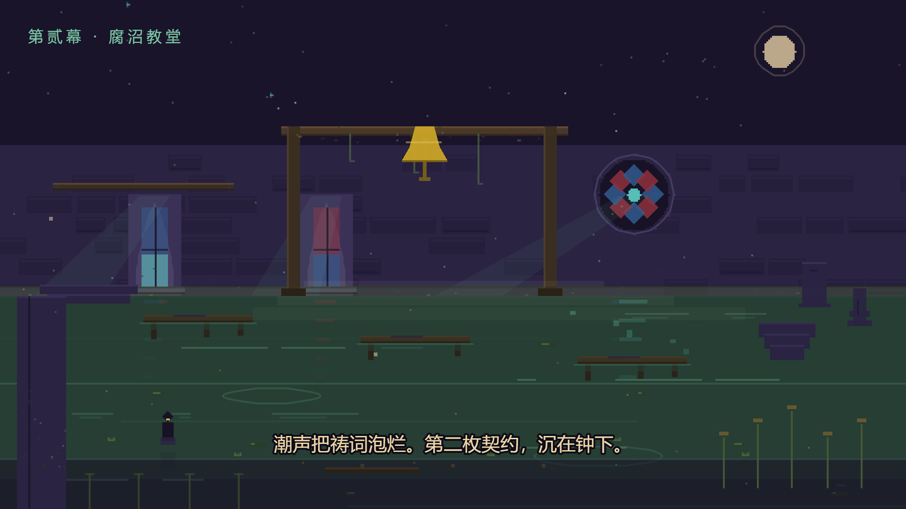
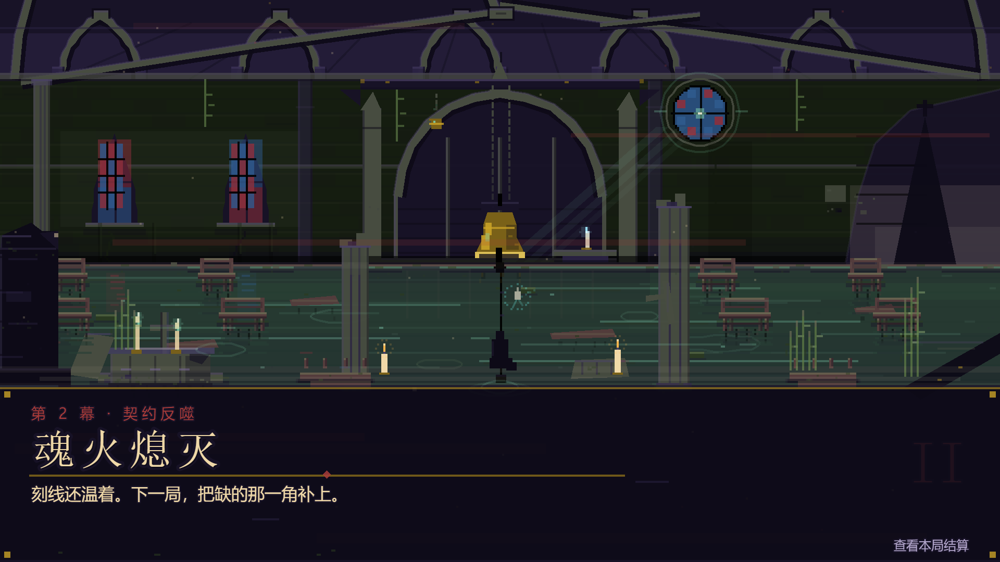
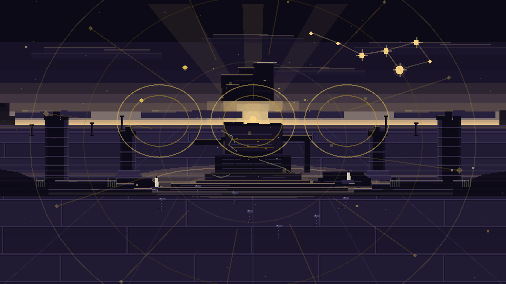

# 过场动画（Cinematics）· 设计、接入与验收

> 目标：把「标题 → 选套 → 三幕战斗 → 幕间 → 终局 / 死亡 / 再战 / 返回标题」的每一次切场都改成**有内容的过场**，并且**无缝**——不黑屏、不闪一帧空场景、输入不穿透、可跳过。
> 接入提交：见 `git log --grep 过场`。

## 一、全流程覆盖

| 触发 | 类型 | 时长 | 画面内容 |
| --- | --- | --- | --- |
| Boot → 标题 | `boot` | 960ms | 祭坛符环收拢、浮尘上升，揭开标题页 |
| 标题 → 选套 | `sigil` | 920ms | 符环扩张 + 黄铜短卡「起手契约」 |
| 选套 → 第一幕 | `act` | 1460ms | 荒废墓园剪影（墓碑/尖拱/枯树/烛火）+ 幕名 + 一句世界观字幕 |
| Boss 通幕 → 幕间 | `clear` | 1420ms | 「契约解除」+ 用时/击杀/脉流/联组四项数据 + 封印碎片飞散 |
| 幕间 → 第二幕 | `journey` | 5840ms | 横移长镜头：走出墓碑群、沼水雾带、教堂彩窗逐格亮灯 + 幕名角标（详见 [开场与幕间.md](开场与幕间.md)） |
| 幕间 → 第三幕 | `journey` | 5840ms | 彩窗暗灭、镜头上摇、星纹垂落、王庭立柱与王座浮现 + 幕名角标 |
| 第三幕通关 → 结局 → 结算 | `victory` | 1600ms | 三环向心合并 + 黄铜闪洪 + 「契约终结」；之后接 32s 结局演出（见 [结局与演职员.md](结局与演职员.md)） |
| 死亡 → 结算 | `death` | 1120ms | 血色收边 + 灰烬下落 + 「魂火熄灭」 |
| 结算 → 再战 | `retry` | 920ms | 短转场「再入契约」，不重复整张幕名卡 |
| 结算 / 战斗菜单 → 标题 | `return` | 920ms | 「祭坛暂歇」 |

短过场总时长全部落在 **900–1600ms**；幕间 journey 为 **5840ms**（cover 320 / hold 5200 / reveal 320，2026-11-07 起）。任意键/点击可跳过，转入后 150ms 内的那一下不算跳过（防止触发键顺带吞掉转场）。

## 二、为什么是「无缝」的

1. **先盖住，再换场**：旧场景被暂停但仍在渲染；覆盖层完全盖满（`coverMs`）后才 `stop` 旧场景、`launch` 目标场景。注意 `stop` 的判定是 `isActive(from) || isPaused(from)`——真实 Phaser 里 `isActive()` 对 PAUSED 场景返回 false，只查 isActive 会漏停已冻结的源场景（2026-11-07 修复，见下文 bug 记录）。
2. **目标先就绪，再揭开**：目标场景 `create` 完成事件触发后才允许进入揭开阶段；就绪前计时钉在揭开点，绝不露空帧。
3. **揭开前目标处于暂停**：目标在地底下先冻结，揭开那一刻才 `resume`，玩家不会在标题卡期间先走两步/先挨一下。
4. **没有纯黑帧**：覆盖底色是「祭坛暗紫 + 当幕主题色」，再叠墙带、雾、剪影、符环和浮尘；不是 `#000` 的黑场。
5. **跳过也走同一套**：未换场时跳过 = 立刻换场并进入揭开；再次跳过 = 直接结束。不会出现「跳过以后卡在覆盖层」。
6. **兜底**：目标场景 1500ms 内没有派发 `create` 也强制放行，避免把玩家锁在过场里。

## 三、代码结构

    src/data/cinematics.js     纯数据 + 时间轴/阶段/跳过/卡片文案（无 Phaser，可单测）
    src/ui/cinematic-art.js    程序化像素美术：盖场、三幕剪影、符环、浮尘、碎片
    src/scenes/CutsceneScene.js覆盖层场景：盖场 → 换场 → 冻结目标 → 揭开
    src/ui/transition.js       统一入口 playCutscene(scene, { to, kind, act, payload, report })
    src/main.js                过场场景必须注册在场景列表最后（渲染在最上层）

接入点：`BootScene` / `TitleScene` / `LoadoutScene` / `BattleScene` / `IntermissionScene` / `GameOverScene` 所有正式切场都改为 `playCutscene`。
被过场送进来的场景会收到 `__cine: true`，据此跳过自身的 `fadeIn`，避免「过场揭开 + 场景再淡入」叠两层。

## 四、调试开关

| 参数 | 作用 |
| --- | --- |
| `?cine=0` | 关闭过场，退回普通切场（调试/自动化用） |
| `?stress=1` | 压测模式同样关闭过场 |
| `?scene=battle` / `?scene=gameover` | 保留原调试直达；开场过场会在揭开时落到直达场景 |

## 五、真实浏览器验收（已执行）

2026-11-06 在真实 Edge（Playwright `channel: 'msedge'`）里跑通，1920×1080 桌面 + 390×844 竖屏两档。**16 张截图、0 个 pageerror、9 段过场时长全部在 900–1600ms**；逐项断言在 [verify.json](cutscene/verify.json)。

| 第一幕标题卡（逐字砸落） | 揭开瞬间（底下的战斗已经就绪） | 第二幕 journey |
| --- | --- | --- |
|  |  |  |

| 第三幕标题卡 | 通幕统计 | 竖屏第一幕 |
| --- | --- | --- |
|  |  |  |

| 契约解除 | 魂火熄灭 | 契约终结 |
| --- | --- | --- |
|  |  |  |

| 胜利结算 | 竖屏 390×844 第一幕 |
| --- | --- |
|  |  |

### 无缝的硬证据

标题卡停留时，脚本直接读战斗场景状态：

```json
{ "battleCreated": true, "battleStatus": 6, "cutActive": true }
```

`battleStatus: 6` 是 Phaser 的 `PAUSED`——战斗场景已经 `create` 完成、在覆盖层底下冻结待命，揭开时才放行；`05b-act1-reveal.png` 能看到标题卡淡出后，玩家、HUD 与罗盘已经在同一帧里，没有黑场或空场景过渡。

### 真机踩到并修掉的 bug

首轮浏览器跑「跳过」时，目标场景会永久停在暂停态：`SceneManager` 的 `pause/resume` 是**排队操作**，跳过时 `resume` 可能先于 `pause` 落地，于是 resume 被当成无效操作，随后 pause 生效，目标就再也起不来。修法：

- `freezeTarget` 在已经进入揭开阶段时不再补暂停；
- `resumeTarget` 无条件排 resume，并启动 `ensureTargetRunning` 短计时器看门狗（约 400ms 内反复确认目标不在暂停态）；
- 看门狗带 owner 标记，新过场一开，旧看门狗自动停，不会误放行新过场的目标。

这条是单元测试替身测不出来的（假 SceneManager 会立即应用 pause），只有真实浏览器能暴露；复跑 `scripts/cutscene-shot.mjs` 会持续守住。

2026-11-07 开场动画验收又踩到同族的一条：**PAUSED 源场景泄漏**。`swapScenes` 原来只在 `isActive(from)` 时 `stop` 旧场景，而真实 Phaser 的 `isActive()` 仅对 RUNNING 为 true——被盖场阶段暂停的源场景永远不被 stop，PAUSED 场景仍渲染，于是 StoryScene 的冻结末帧盖住了标题页与后续所有画面（旧流程因目标渲染序在源之上而被掩盖，开场 StoryScene→TitleScene 是唯一源渲染序高于目标的流程，首次踩中）。修法（提交 `fdebbef`）：`stop` 判定改为 `isActive(from) || isPaused(from)`；单测 harness 的 `isActive` 同步对齐真实语义（PAUSED 不算 active）并加回归测试。修复后重跑 `scripts/story-shot.mjs`，标题页/战斗/竖屏标题逐张目检确认正常，证据见 [开场与幕间.md](开场与幕间.md)。

### 离线构图预览（辅助，不是证据）

在没有浏览器权限的阶段，用同一套 `cinematic-art.js` 绘制指令经 Pillow 重放生成的构图检查图仍在 `docs/cutscene-preview/`。几何/颜色/层级一致，但字体光栅化与 Phaser 有差异，**不作为验收证据**。

## 六、复跑与单测

```bash
npm test          # 66 个文件 / 1269 项全绿（2026-11-12 复核，过场重做后）
npm run build     # 生产构建通过
node scripts/static-server.mjs dist 4174
BASE_URL=http://127.0.0.1:4174 node scripts/cutscene-shot.mjs
```

> 在受限沙箱里跑浏览器时，把 `TEMP`/`TMP` 指到工作区（`TEMP=$PWD/.tmp/pw-temp TMP=$PWD/.tmp/pw-temp`），否则 Playwright 会在系统临时目录上 `EPERM`。

新增测试：

- `tests/cinematics.test.js`：时间轴总长、阶段边界、跳过语义、三幕文案、卡片数据。
- `tests/cutscene-scene.test.js`：用最小 Phaser 替身跑换场状态机（盖满才换场、目标冻结/放行、目标未就绪不揭开、跳过不会软锁、八类过场都能走完）。
- `tests/transition.test.js`：`?cine=0` 退回、重复触发、无覆盖层、幕号解析。

性能：长透视线/符环辐条从「Bresenham 逐像素 fillRect」换成 1px 矢量线、符环改 48 段折线描边，单帧绘制指令从 **约 8000 条降到 500–700 条**；短装饰线仍保留像素楼梯。

## 七、开场动画与幕间 journey（2026-11-07 扩展）

在本系统之上新增了 36 秒六镜剧情开场（Boot → StoryScene → 标题页）与两段 5840ms 幕间 journey（幕间 → 二/三幕），复用同一套 Cover→Swap→Freeze→Reveal 机制；第一幕入场保持 `act` 标题卡不变。分镜表、真实浏览器验收结果（14 截图 / 11 check / 0 pageerror）与复跑命令见 [开场与幕间.md](开场与幕间.md)，验收脚本为 `scripts/story-shot.mjs`，证据在 `docs/story/`。

## 八、短过场大胆化编舞（2026-11-08 扩展）

短过场的**视觉**从「统一符环 + 标题卡淡入淡出」升级为每类专属编舞，**状态机与时长一行不动**（仍 900–1600ms）。新增 `src/ui/cutscene-choreo.js`：`createChoreo(kind, act)` 返回每类编舞，CutsceneScene 只把视觉块委托给它（journey 仍走自有分支）。

| 类型 | 编舞 |
| --- | --- |
| `act` | cover 甩镜 streak + 巨号幕数字 I/II/III 垫底；幕名拆 ≤4 单字依次砸落（easeOutBack 过冲）；落地震屏 + 幕色闪洪 + 符环过冲 + cineSlam |
| `clear` | hold 起点符环碎裂飞散（cineShatter）+ 统计 60ms stagger 弹出；reveal 12 列硬边百叶擦除 |
| `death` | cover 血色 iris 收拢；hold glitch 切片 + 双跳心跳脉冲；reveal iris 张开 |
| `victory` | hold 三环向心合并 + 黄铜闪洪 + 加性核心辉光（cineShatter） |
| `boot/sigil/retry/return` | 符环过冲 punch + 紧凑标题砸落 + 1 帧幕色 tick |

2026-11-12 起编舞进一步瘦身：**视觉内容整体迁到 `src/ui/cine-beats/`**，`cutscene-choreo.js` 只负责镜头运动（甩镜、闪洪、震屏、百叶、iris）与卡片动效，布景由静态三层提供，详见第十节。

纪律不变：硬边整数坐标、种子确定、无渐变/模糊/Math.random。编舞里符环 `runes:false`（省约 250 指令）把预算让给冲击层；四层（舞台/符环/浮尘/加性）合计**最坏帧 ≤700 指令**，由 `tests/cutscene-choreo.test.js` 计数 stub 锁定。新增工具函数（drawShatter/drawFlood/drawWhipStreaks/drawIris/drawGlitchSlices/drawNumeral）在 `src/ui/cinematic-art.js`。

真实浏览器复跑 `scripts/cutscene-shot.mjs`：15 断言全过、0 pageerror（已对齐 journey/开场新流程：第二幕入场是 journey 而非 act 卡；胜利卡后跳过 32s 结局再落结算）。

## 九、结局演出（2026-11-08 扩展）

第三幕通关不再只落静态结算：`victory` 卡 → 32s 结局四镜（三契尽解 / 法阵安静 / 黎明 / 名单滚动）→ `boot` 交接 → 胜利结算面板。复用 StoryScene 分镜播放器（ending 模式）与程序化配乐。分镜、无缝/跳过死锁修复与验收（8 断言 / 9 截图 / 0 pageerror）见 [结局与演职员.md](结局与演职员.md)，验收脚本 `scripts/ending-shot.mjs`，证据 `docs/ending/`。

## 十、契约碑铭剧场：过场重做（2026-11-12）

### 10.1 诊断：旧过场为什么「简陋、缺辨识度」

| 现象 | 根因 |
| --- | --- |
| 八种过场、七幕看起来都是同一张画 | 所有类型共用「暗紫底 + 居中铜框大卡片 + 中央符环」，卡片约占 65% 画面，正好挡住唯一能提供信息的中景 |
| 场景里只有 3–5 个远景剪影，且一件都认不出 | 旧 `drawStage` 每帧重画全部剪影，第 1 幕 act 已顶到 646/700 指令，没有预算再加细节 |
| 幕与幕只有幕色和幕号不同 | 七幕共用同一棵枯树 + 同一个烛台 + 同一条地面透视缝 |
| 亮部没有主次 | 门缝光是一根实心黄柱、符环贯穿全屏，最亮的东西恰好是最没信息的东西 |

### 10.2 七条原则（写代码时按它判对错）

| 编号 | 原则 | 落地方式 |
| --- | --- | --- |
| P1 | 一剧一景 | 七幕各自一份 `actN.js`，不许跨幕复用构图；共用件只留在 `diorama-kit.js`（拱、柱、烛、链、碎屑等几何原语） |
| P2 | 三拍 | 每类事件按 准备 → 行动 → 结果 编排；结果必须**留在画面上**（`residueAt()` 可查询残留） |
| P3 | 材质依附 | 所有纹理线（砖缝、木纹、苔、锈）只画在实体上，不许铺在空处冒充细节 |
| P4 | 三层纵深 | 每幕固定 back（天幕/远景）/ mid（地面 + 主体）/ fore（压边）三层，近排与远排必须能靠明度分开 |
| P5 | 卡片让位 | 标题卡退成底部通栏碑座，场景占上方约 62–75%，中景完整可见 |
| P6 | 幕色只上光源 | `accent` 只给光源、纹样、事件高光（小面积）；`tint` 只做底色（大面积）。禁止把 accent 铺成色块 |
| P7 | 硬边像素 | 坐标全整数、硬边色块、固定种子 LCG、零渐变零模糊、零 `Math.random` |

### 10.3 分层架构与预算

```
src/ui/diorama-kit.js        布景原语（fill/courses/bricks/ashlar/pointedArch/roundArch/archWindow/
                             column/beam/planks/steps/cracks/moss/rubble/water/starfield/chain/candle/
                             silhouette/floor/disc/ring/ellipseRing）
src/ui/dioramas/registry.js  七幕注册表 + BAND_BUDGET + 归一化锚点 → 像素换算（dioramaLayout/drawBand）
src/ui/dioramas/act1..7.js   七幕布景：export back / mid / fore / anchors
src/ui/cutscene-plinth.js    碑座布局纯函数 plinthLayout + toLocal
src/ui/cine-props.js         过场道具（钉、契约主剪影、魂火、七星、灰堆、血纹、雾、烛）
src/ui/cine-beats/short.js   boot / sigil / retry / return 四类三拍事件
src/ui/cine-beats/battle.js  act / clear / death / victory 四类三拍事件
src/ui/cutscene-choreo.js    编舞：只排镜头运动与卡片动效，视觉内容全部交给事件库
```

- **静态三层**：`CutsceneScene.create` 里每层各画一次（`drawBand`），之后每帧只 `setAlpha`，近景再叠 2px 整数下沉做视差 —— 这是能加细节的根本原因：每帧预算不再被剪影吃光。
- **预算**：`BAND_BUDGET = { back: 1300, mid: 1300, fore: 900 }`（create 时一次性绘制）；活动件（遮罩/符环/浮尘/加性/事件）合计每帧 ≤ 700，由 `tests/cutscene-choreo.test.js` 的计数 stub 锁定。
- **锚点**：每幕用 0..1 归一化坐标声明 `seal / gate / nail / lord / light`，`dioramaLayout` 换算成当前画布像素，因此横屏 480×270 与竖屏 480×760 共用一份布景数据；缺哪个锚点就退回中央符环，事件代码不用判空。

| 幕 | seal（符环） | gate（门/窗） | nail（契约钉） | lord（契约主） | light（主光源） |
| --- | --- | --- | --- | --- | --- |
| I 荒废墓园 | 0.5, 0.40 | 0.271, 0.42 | 0.5, 0.6815 | 0.5583, 0.5556 | 0.2208, 0.1704 |
| II 腐沼教堂 | 0.5, 0.42 | 0.5, 0.58 | 0.5, 0.6815 | 0.5, 0.563 | 0.7, 0.2 |
| III 星陨王庭 | 0.5, 0.42 | 0.5, 0.58 | 0.5, 0.6815 | 0.5, 0.563 | 0.5, 0.2296 |
| IV 沉钟书库 | 0.5, 0.42 | 0.5, 0.58 | 0.5, 0.6815 | 0.5, 0.563 | 0.5, 0.2296 |
| V 衡律法庭 | 0.5, 0.42 | 0.5, 0.58 | 0.5, 0.6815 | 0.5, 0.563 | 0.6875, 0.3111 |
| VI 熔星锻炉 | 0.5, 0.42 | 0.5, 0.58 | 0.5375, 0.6815 | 0.5375, 0.5185 | 0.4292, 0.4444 |
| VII 破晓之座 | 0.5, 0.42 | 0.5, 0.58 | 0.5, 0.6889 | 0.5, 0.5778 | 0.5, 0.42 |

（未列出的幕沿用「门/钉/主」在中央的默认值；`r` 半径随画布短边换算。）

### 10.4 碑座替代居中卡片

标题卡不再是盖住中景的铜框，而是画面底部一条**通栏铭文带**（横屏 84px、竖屏 104px、紧凑卡 176×44）。布局由纯函数 `plinthLayout()` 返回画布绝对坐标，再经 `toLocal()` 转入卡片容器（容器本身仍建在中心，因为编舞用 `card.setY(card.y+2)` 做落地抖动）。

| 元素 | 位置 |
| --- | --- |
| 铭文带底板 | 通栏，贴底，上沿 1px 黄铜受光线 |
| 幕号 numeral | 带内左侧水印 |
| 幕名 | 带内居中（act 逐字砸落） |
| 统计四项 | 带内等宽排布（clear 60ms stagger 弹出） |

编舞依赖的五个字段（`titleChars / titleText / titleBaseY / statValues / statBaseY`）在碑座改造中原样保留，所以 `tests/cutscene-choreo.test.js` 不用改替身。

### 10.5 八类过场各自的三拍

| 类型 | 准备 | 行动 | 结果（留在画面上） |
| --- | --- | --- | --- |
| boot | 三支烛依次点亮 | 火苗被拉长成符环 | 环常明、浮尘上升 |
| sigil | 契约钉落到石面 | 触石震屏 + 石屑迸出 | 符环从钉帽向外扩 |
| act | 门缝先透出一线光 | 光缝撑开到 6px、契约主在门内现身 | 门缝与剪影**留在场上**，幕数字压印在碑座上 |
| clear | 契约主影子开始颤动 | 崩解成灰、契约钉被拔起 | 灰堆 + 断成两截的钉 + 地面裂纹常留 |
| death | 契约主剪影跪倒 | 魂火升起被吹散 | 血纹从脚下蔓延成四段、两盏烛熄 |
| victory | 七枚钉从北斗七方位升起 | 向心汇成一枚星并炸开 | 七星连线常亮 |
| retry | 契约出现断口 | 刻笔逐段补刻 | 刻线合拢留在碎片上 |
| return | 雾从两侧卷来 | 烛逐盏熄灭 | 只余中央一盏 |

事件库统一接口：`{ beats: { prepare:[a,b], action:[c,d], result:[e,f] }, draw(scene, ctx), residueAt(holdP) -> string[] }`，`ctx = { w, h, holdP, phase, anchors, accent, tint, seed, act, horizon }`；`draw` 只能碰 `stageG / sealG / dustG / fxG` 四层，不许建对象、不许改文字。`residueAt(0)` 必为空、`residueAt(1) === residueAt(0.9)`。

### 10.6 七幕布景一览

七幕各一份 `src/ui/dioramas/actN.js`，每份导出 `back / mid / fore / anchors`。下表是 2026-11-12 终版的构图主线与专属标志物——**判断"有没有辨识度"就看这一列能不能说出三件只有这一幕才有的东西**。

| 幕 | back（天幕/远景） | mid（地面/主体） | fore（压边） | 专属标志物 | 主光 |
| --- | --- | --- | --- | --- | --- |
| I 荒废墓园 | 五段天幕 + 残月冷晕 + 三条月下云带 + 夜鸟；矮墙 + 五个盲拱祭龛 + **残破礼拜堂**（塔身/雉堞/侧殿/双尖窗）+ 尖拱门洞 | 三排纵深石板 + 7 条竖缝 + 主裂缝；**三排墓碑（近 `stoneLight` / 中 `stone` / 远 `stoneDark` 空气透视）** + 十字碑与乌鸦 + 断裂石棺 + 9 根铁栅栏 | 左上枯枝抱框（4px 主枝 + 6 副枝）+ 右下残碑 | 尖拱门洞与门槛光、三排墓碑与十字碑、断裂石棺、铁栅栏铜灯 | 残月（light 0.2208, 0.1704） |
| II 腐沼教堂 | 石肋拱顶（`fillPoints` 实心肋带）+ 三扶壁 + **圆彩窗 + 两扇红蓝尖窗** + 破墙剪影 | 泛水地板（岸线/亮线/涟漪/纵深暗带 + 彩窗碎光倒影）+ 泡水长椅（近排翻倒）+ **铁链吊钟** + 冷烛小祭台 + 水中歪十字 + 吊香炉 | 沼水岸线与芦苇压边 | 圆彩窗、吊钟（钟轭/钟舌/钟舌索）、长椅倒影、水中歪十字 | 彩窗（light 0.7, 0.2） |
| III 星陨王庭 | V 形坍顶破口（三重描边）+ 星野 + 陨星划痕；**断裂栏板**（三段垛口、破洞与星纹环处留缺口） | **三级台基**（踏面受光/踢面压暗/扶壁打断横线）+ 王座（靠背 32uw、断齿双肩、星纹背板）+ 陨坑残火 + 6 块悬浮碎星 + 断拱残段 + 倒柱 + 王冠碎片 + 阶前石道 | 两侧断柱与碎石压边 | 破口与星纹环、三级台基、王座、陨坑 + 悬浮碎星 | 破口冷蓝（light 0.5, 0.2296） |
| IV 沉钟书库 | 尖拱高窗 + 月盘 + 木梁 + 三档明度书架（书脊三色排除法相邻不同色）+ 残烛 | 三排石板 + **梁下吊钟**（钟架横梁只覆盖钟口宽 + 两侧 28u、牛腿石托、`shortChain` 短链、钟轭、钟身 `brassDark` 剪影 + 左棱 1px 受光、钟口 0.7× 收分暗腔 + 唇边封口）+ 整块梯形织毯（单次多边形 fill + 同形 `void` 暗底 + 1px 织纹 + 流苏 + 磨损缺口）+ 书梯 + 阅读台 + 翻飞书页 | 石立柱 + 内侧书架 + 4 级阶梯拱腹（朝场内 1px accent 窗光） | 尖拱高窗与月盘、梁下吊钟、书梯、翻飞书页、拱腹画框 | 高窗月光（light 0.5, 0.2296） |
| V 衡律法庭 | 玫瑰窗（竖屏才有）+ 两扇深蓝尖窗（4 横棂、光只落窗下半部）+ 柱廊（三档明度 + 3 凹槽 + 三级柱头柱础 + 柱础落地影）+ 8 段深廊 | 7 排透视地面（**整排铺完再统一画缝**，1px void + 1px 亮唇）+ 6 条灭点楔缝 + 踢脚线 + **天平**（三段横梁/4 组双吊链/盘口/两级石座）+ **三块判词碑（圆首歪立 46×64 / 尖首正立 34×46 / 崩口残齿 26×34）** + 碑额星纹 + 碑脚蜡印 + 法官椅 + 前后两排栏杆 + 卷宗堆 + 烛架 + 法槌头 | 栏杆与柱脚压在带口 | 天平、三块姿态不同的判词碑、柱廊、尖窗光柱 | 右窗冷光柱（light 0.6875, 0.3111） |
| VI 熔星锻炉 | 炉膛拱 + 火焰 + 烟罩 + 风箱 + 吊链 + 煤堆 | **铁砧**（暗铁剪影 + 砧脚集中炉光）+ 锤 + 铸模架 + 水槽 + 火星 | 炉前渣堆与铁料压边 | 炉膛与火焰、铁砧、吊链、风箱 | 炉火（light 0.4292, 0.4444） |
| VII 破晓之座 | 五段天幕 + **8 条暖→冷晨光带**（最亮贴地平线）+ 三层同轴光柱 + 云海 + **北斗七星（4 大 3 小 + 断续连线）** | 断裂王座（左肩高 74 / 右肩矮 94，**故意不对称**——对称断口会被读成拱门或双塔）+ 三级台座 + 四断柱 + 两座倒伏方尖碑 + 错位断裂石板透光 | 阶下低雾 + 残烛 + 倒伏幡 | 断裂王座、北斗七星、晨光带、光柱光池 | 日出（light 0.5, 0.42） |

### 10.7 量化验收

指标全部来自真实浏览器截图，脚本 `scripts/lib/pixel-signature.mjs` 把画面降采样成 **48×27** 格，每格记 RGB 3bit 与"是否边缘"，再算：

- **ink**：偏离主色（通道差 > 12）的像素占比 —— 只用来判断"整屏是不是一片平色"。
- **detail**：与上下左右四邻亮度差 > 0.012 的格子占比 —— 局部对比覆盖率，空场会掉到 0.07 以下。
- **buckets**：4bit 量化后的颜色桶数 —— 拦"整屏单色"。
- **distance(a, b)** = `0.4 × colorMean + 0.6 × edgeRatio`。只用亮度会被骗：七幕整体亮度分布相近，第 1 幕与第 3 幕纯亮度距离只有 0.024（肉眼完全不同），加上边缘结构差才拉到 0.227。

阈值 `THRESHOLDS = { ink: 0.55, detail: 0.12, buckets: 18, actDistance: 0.18, kindDistance: 0.10 }`。其中 **ink 0.55 只是期望值、不作闸门**：暗调像素画主色天然占大半画面，硬卡会让"为了达标往画面刷亮块"变成目标；闸门是 detail / buckets / 两两距离。

实测（2026-11-12 终版，`docs/cutscene/signatures.json`）：

| 幕 | I | II | III | IV | V | VI | VII |
| --- | --- | --- | --- | --- | --- | --- | --- |
| ink | 0.472 | 0.772 | 0.603 | 0.798 | 0.793 | 0.799 | 0.795 |
| detail | 0.329 | 0.529 | 0.430 | 0.525 | 0.441 | 0.346 | 0.454 |
| buckets | 28 | 42 | 35 | 87 | 62 | 51 | 39 |

21 组两两指纹距离 **0.212–0.305**（最近的是 I–III = 0.212，阈值 0.18；次近 IV–VII = 0.245）；同幕不同种类的距离阈值 0.10。

静态三层指令数（`BAND_BUDGET = { back: 1300, mid: 1300, fore: 900 }`，口径与 `tests/diorama-registry.test.js` 的计数 stub 一致）：

| 幕 | 横屏 480×270（地平线 / back / mid / fore / 合计） | 竖屏 480×760（地平线 / back / mid / fore / 合计） |
| --- | --- | --- |
| I | 120 / 602 / 1058 / 440 / 2100 | 338 / 646 / **1277** / 440 / 2363 |
| II | 127 / 567 / 912 / 82 / 1561 | 357 / 861 / **1244** / 84 / 2189 |
| III | 124 / 659 / 936 / 148 / 1743 | 350 / 718 / 1084 / 148 / 1950 |
| IV | 132 / 845 / 608 / 234 / 1687 | 372 / 1120 / **1049** / 385 / 2554 |
| V | 135 / 527 / 593 / 51 / 1171 | 380 / **1233** / 747 / 51 / 2031 |
| VI | 135 / 499 / 371 / 175 / 1045 | 380 / 527 / 534 / 411 / 1472 |
| VII | 119 / 282 / 725 / 70 / 1077 | 334 / 331 / 894 / 70 / 1295 |

粗体是接近上限的带（竖屏中景 1277 / 1244，竖屏远景 1233 / 1120）。竖屏比横屏高 490px，同样的物件要铺更多地面与柱身，所以竖屏是真正的预算瓶颈 —— 下一轮加细节优先看竖屏。

复跑命令：

```bash
npx vite build --configLoader native
node scripts/static-server.mjs dist 4174        # 另开一个窗口
BASE_URL=http://127.0.0.1:4174 node scripts/with-cdp.mjs scripts/cutscene-shot.mjs
# 沙箱里无头浏览器要用 CDP 附连（Playwright 的 --remote-debugging-pipe 会被 EPERM 拦）
```

输出：17 断言全过 + `docs/cutscene/01..16*.png` 共 22 张 + `signatures.json` + `verify.json`。七幕画廊在 `docs/cutscene/16-actN-scene.png`。

### 10.8 纪律（2026-11-12 修订，写新细节前先读）

1. **一剧一景**：不许跨幕复制构图；共用件只留在 `diorama-kit.js`，且必须是几何原语（拱/柱/链/烛/碎屑），不是"整块背景"。
2. **材质线必须依附实体**：砖缝贴地、木纹贴梁、苔贴石根、锈贴铜件。铺在空处的纹理线一律删。
3. **幕色只上光源**：`accent` 只给受光棱、纹样、事件高光（小面积，`mid` 带 accent 指令 ≤ 40）；大面积底色用 `tint`。禁止整片染色。
4. **fore 层不画地面**：地面画在 fore 会盖住中景（第 1 幕踩过）。
5. **坐标全整数、种子确定**：零渐变、零模糊、零 `Math.random`。
6. **竖屏用尺度变量 `u`，不写死像素**：硬编码横屏 y 坐标会让物件在竖屏掉到碑座下面；柱基、地平线、地面排数都要跟着 `L.tall` / `horizon` 走。
7. **改完必须目检**：`node scripts/preview-diorama.mjs N` 出 2× 预览（横竖屏各一张），至少看两轮局部放大；1px 材质线在 2× 下看得见、实机叠 `tint` 后可能就看不见（第 II 幕的"细铁丝拱顶"就是这么来的）。
8. **加细节后重跑**：`npx vitest run --configLoader native --pool threads`（全量）+ `npx vite build` + 截图脚本；预算、指纹与 screenshot 三样都要过。
9. **改源码后必须重新 build 再截图**，否则 dist 还是旧画面，会白目检一轮。

## 十一、幕间与开场/结局的三层静态化（2026-11-12，T17–T19）

### 11.1 为什么重做

短过场（boot/act/clear…）走的是「一剧一景 + 三层静态 + 事件三拍」。开场、幕间、结局三条演出线当时还停在旧笔刷：每帧把整幅背景重画一遍，物件少、亮度低，实测旧 journey 第贰幕截图 **ink 0.041 / detail 0.067**（对比重做后七幕 detail 0.33–0.53）—— 就是用户说的"简陋、缺辨识度"。这一轮把三条线统一到同一套分层契约上。

### 11.2 分层契约（三条线共用）

| 层 | 职责 | 绘制时机 |
| --- | --- | --- |
| back | 天幕、远景剪影（塔、拱、山脊、星野） | 进场画一次 |
| mid | 地平线到地面的透视板 + 本场主体（钟、王座、天平、书架…） | 进场画一次 |
| fore | 只压边：前景残件、草、雾带（**绝不画地面**） | 进场画一次 |
| dyn | 钟摆、翻页、火星、雨、晨光带、瞳孔高光等会动的部分 | 每帧 `clear()` 后重画 |

- 幕间：`src/ui/journey-static.js` 提供 `JOURNEY_STATIC[stage] = { back, mid, fore }`、`JOURNEY_STAGES[stage]`（每帧动态三拍）、`journeyLayout(stage, w, h)`、`journeyPan(p)` 与视差常量 `JOURNEY_PARALLAX = { back: 12, mid: 30, fore: 52 }`。`CutsceneScene` 的 journey 分支把三层画进一个 `depth 1.2` 的静态容器，动态层每帧重画，再按 `pan` 位移三带做出「镜头横移」。
- 开场/结局：`src/ui/story-art.js` 提供 `OPENING_STATIC[shot]` / `ENDING_STATIC[shot]`（同为三带）与 `OPENING_STAGES` / `ENDING_STAGES`。`StoryScene` 用 `backG / midG / foreG`（depth 0 / 0.4 / 0.7）三个 Graphics，**换镜才 `paintStatic`**，动态层每帧。
- 回归测试（`tests/story-scene.test.js`）里有三条「静态布景只画一次」的用例，防止以后又退回"每帧全量重绘"。

### 11.3 幕间六段（journey）

| 段 | 静态主体（back / mid / fore） | 每帧动态 |
| --- | --- | --- |
| swamp 腐沼 | 月盘、沼雾、主祭坛残骸、吊香炉、湿痕 / 钟架（石础+斜撑+绞盘滑轮）+ 金钟 + 三排长椅（一张翻倒半沉）+ 圆彩窗 / 远岸土坎、芦苇、半沉木桩、近景浮萍 | 钟摆、水面涟漪、烛火、萤点 |
| star 星陨 | 星野 + 北斗 / 断栏板 + 三级台基 + 王座 + 陨坑 + 悬浮碎星 / 碎屑 | 碎星浮沉、坑火 |
| library 书库 | 高窗月盘 + 梁架 / 书架两排 + 铜钟 + 书梯 + 阅读台 / 落地书堆 | 翻飞书页 |
| court 法庭 | 柱廊与玫瑰窗 / 天平（抬到碑顶之上、双盘 V 形第二节吊链）+ 三块判词碑 + 栏杆 + 通向台座的红毯 / 卷宗、柱影 | 吊链微摆、冷光柱浮尘、碑铭点亮 |
| forge 锻炉 | 烟囱与火光天幕 / 炉膛 + 铁砧 + 吊链 + 风箱 / 水槽蒸汽 | 火星、炉火脉搏 |
| sunrise 破晓 | 晨光带（暖→冷八条）+ 远山两层 / 断王座 + 北斗连线 / 残烛 | 光带推移、浮尘 |

指令数（`back + mid + fore = 合计`，dyn = 每帧动态；预算 单带 ≤1300 / 单幕 ≤3200 / 动态 ≤700）：

| 段 | 横屏 480×270 | 竖屏 480×760 |
| --- | --- | --- |
| swamp | 916+336+124=1376，dyn 194 | 1090+340+124=1554，dyn 239 |
| star | 480+412+204=1096，dyn 110 | 543+776+388=1707，dyn 110 |
| library | 684+152+114=950，dyn 123 | 828+214+172=1214，dyn 127 |
| court | 860+246+84=1190，dyn 212 | 1164+246+84=1494，dyn 256 |
| forge | 398+296+292=986，dyn 361 | 446+373+462=1281，dyn 492 |
| sunrise | 518+192+74=784，dyn 251 | 674+208+74=956，dyn 260 |

### 11.4 开场六镜（36000ms）

| # | shot | 时长 | 静态主体 | 动态 |
| --- | --- | --- | --- | --- |
| 1 | skyfall | 6000 | 星野、两道陨星划痕、远山 | 陨星拖尾、星点闪烁 |
| 2 | contracts | 6000 | 七座契约台（墓碑/沉钟/王座/书架/天平/铁砧/破晓座）+ 七枚契约印 | 印逐枚点亮、火花、浮尘 |
| 3 | graveyard | 6000 | 残月、尖拱门洞、断柱、栅栏、三排墓碑、枯树 | 门缝光、雾带、萤点 |
| 4 | altar | 7000 | 祭坛 4×4 刻格、两侧尖拱壁龛、两根烛台 | 刻格逐格点亮并连成法阵线、主角剪影上浮 |
| 5 | awaken | 7000 | 星野、两根立柱、三级祭坛台、方尖碑 | 符环扩张、光柱升起、浮尘 |
| 6 | title | 5000 | 北斗七星、标题碑、两根立柱与吊链 | 星点呼吸、碑面菱形脉动 |

静态指令数：skyfall 362/416（横/竖，下同）、contracts 476/756、graveyard 788/854、altar 458/514、awaken 660/892、title 334/442；动态 42/358/356/96/374/368。

### 11.5 结局四镜（32000ms）

| # | shot | 时长 | 静态主体 | 动态 |
| --- | --- | --- | --- | --- |
| 1 | release | 7000 | 七座契约台 + 七枚解除中的印 + 远景山脊 | 印环碎裂飞散、"契约终结"浮现 |
| 2 | quiet | 7000 | 星陨后的废土、残柱、断碑 | 灰烬下落、微光 |
| 3 | dawn | 8000 | 暖→冷八条晨光带、远山、尖拱门、墓碑、枯树 | 日轮升起 + 光晕、疏状光柱、地面短光条 |
| 4 | credits | 10000 | 主碑 + 断王座 + 北斗 | 星点、浮尘、缓慢推近 |

静态指令数：release 344/380、quiet 514/514、dawn 758/862、credits 376/500；动态 626/280/220/126。

### 11.6 验收

```bash
npx vitest run --configLoader native --pool threads    # 66 文件 / 1269 项全绿
npx vite build --configLoader native                   # ✓ built
node scripts/static-server.mjs dist 4174               # 另开窗口
BASE_URL=http://127.0.0.1:4174 node scripts/with-cdp.mjs scripts/story-shot.mjs   # 14 张，ok: true
BASE_URL=http://127.0.0.1:4174 node scripts/with-cdp.mjs scripts/ending-shot.mjs  # 9 张，ok: true
BASE_URL=http://127.0.0.1:4174 node scripts/with-cdp.mjs scripts/cutscene-shot.mjs # 22 张，ok: true
```

截图：`docs/story/01..13*.png`、`docs/ending/01..09*.png`、`docs/cutscene/01..16*.png`。

工具链两条修正（别的脚本照抄这两个坑）：

1. **七幕注入**：`ending-shot.mjs` 的 `forceVictory()` 原来只写三幕跑分并 `s.act = 3`，七幕版里第三幕结束会走 journey 而不是 victory，脚本会卡在等 `kind === 'victory'`。现改为七条 `run.reports`（kills 140…200，合计 1190）、七条 `bossResolutions`、`s.act = 7`，并同步把结算断言改成 `panel.kills === 1190`。
2. **CDP 附连**：沙箱下 `chromium.launch()` 走 `--remote-debugging-pipe` 会被 EPERM 拦死，必须用 `scripts/with-cdp.mjs` 起一个 headless Edge（`--remote-debugging-port=9333`）再把 `PW_CDP_URL` 传给 `scripts/lib/browser.mjs` 的 `openBrowser()`。同一时刻只能跑一个脚本（端口冲突）。

3. **2026-11-12 晚的环境阻断（记录，不是代码问题）**：本轮第五轮打磨（act4 / act5 / journey forge / 结局三镜）之后，沙箱开始禁止 Edge 创建 mojo 命名管道，Edge 一启动就 `FATAL:mojo\public\cpp\platform\platform_channel.cc:187 Check failed: Access denied (0x5)` 立刻退出，`connectOverCDP` 只能连上一个马上要死的浏览器（`Timeout 30000ms exceeded`）。试过 `--single-process --no-zygote --no-sandbox --disable-gpu` 与换端口/换 profile，全部同样 FATAL；放宽沙箱需要人工审批，本轮不可用。已排除的替代路径（2026-11-12 18:1x 复测）：Playwright 自带的 **Firefox 也一样起不来**（`spawn EPERM`，Node 子进程被沙箱拦），`chromium_headless_shell` 与 Edge 同源同样 `mojo` FATAL，`sandbox_permissions: danger-full-access` 两次都卡在审批超时。所以本会话只剩软渲染一条路（见 11.6 末尾「软渲染回退指纹」）。原验收因此变成：

- **最后一次三个截图脚本全绿是在这轮改动之前**（22 / 14 / 9 张、`ok: true`），10.7 的指纹表与 `docs/*/` 下的 PNG 都是那一版的证据；
- 这轮改动量的验收靠 `npx vitest run`（66 文件 / 1269 项）+ `npx vite build` + 软渲染预览（`preview-diorama.mjs` / `preview-story.mjs` / `preview-journey.mjs`）+ 局部放大目检；
- 能开浏览器时请补跑这三条（顺序执行，勿并发）：

```bash
npx vite build --configLoader native
node scripts/static-server.mjs dist 4174
BASE_URL=http://127.0.0.1:4174 node scripts/with-cdp.mjs scripts/cutscene-shot.mjs
BASE_URL=http://127.0.0.1:4174 node scripts/with-cdp.mjs scripts/story-shot.mjs
BASE_URL=http://127.0.0.1:4174 node scripts/with-cdp.mjs scripts/ending-shot.mjs
```

跑完把 `docs/cutscene/signatures.json` 的 ink / detail / buckets 抄回 10.7。
#### 软渲染回退指纹（2026-11-12 晚新增）

浏览器跑不了时，`scripts/preview-gallery.mjs` 不启动浏览器也能给出同一套指标：它把七幕三层布景用 `scripts/lib/raster.mjs` 软渲染进内存位图，再由 `scripts/lib/soft-signature.mjs` 按与截图版**完全相同**的定义（48×27 盒式降采样、RGB 3bit 格、局部对比 edges、同样的距离公式）算 ink / detail / buckets 与两两距离。

两套数值**不能互相比较**（软渲染没有 veil 叠色、tint、碑座铭文），只能同源纵向对比——它的用途是回答「这轮改动有没有把七幕糊成一片」。

```bash
node scripts/preview-gallery.mjs              # 横屏 480×270
node scripts/preview-gallery.mjs --tall       # 竖屏 480×760
node scripts/preview-gallery.mjs --out=.tmp/preview/sig-head.json
SIGIL_ROOT=.tmp/base node scripts/preview-gallery.mjs   # 对另一个 worktree（旧提交）取基线
```

第七轮打磨（第 I 幕细化）后的软渲染实测：

| 幕 | I | II | III | IV | V | VI | VII |
| --- | --- | --- | --- | --- | --- | --- | --- |
| 横屏 ink | 0.223 | 0.554 | 0.483 | 0.468 | 0.434 | 0.671 | 0.499 |
| 横屏 detail | 0.278 | 0.427 | 0.359 | 0.460 | 0.387 | 0.267 | 0.333 |
| 横屏 buckets | 26 | 40 | 29 | 73 | 57 | 48 | 34 |
| 竖屏 detail | 0.169 | 0.430 | 0.275 | 0.444 | 0.495 | 0.279 | 0.334 |

横屏最近一对 **I–V = 0.255**、竖屏 **I–VII = 0.228**，都高于 0.18 的闸门（打磨前横屏最近是 I–VII = 0.235）。第 I 幕这一轮把 detail 从 0.181 拉到 0.278、ink 从 0.179 拉到 0.223，靠的是天幕（积云/月晕/乌鸦/丘陵/枯林）+ 矮墙后的家族墓室骨龛墙 + 近排碑的碑额浮雕，没有动 mid 的地面与碑群（竖屏 mid 只剩 23 条余量）。

三个短板仍在这里：第 I 幕**竖屏** detail 只有 0.169（横屏 0.278，竖屏多出的 490px 全是大面积低频暗地面，且 mid 预算已满）；第 VI 幕 detail 0.267 但 ink 0.671（大片暖色主色吃掉「偏离主色」统计）；第 V 幕 ink 0.434 最低（法庭整体压暗是刻意的）——所以 ink 永远只作参考。

### 11.7 已知限制（下一轮优先）

> 以下都是 2026-11-12 第五轮打磨后仍然成立的问题，按"1x 下读错"筛选过一遍，不是臆测。

**短过场（七幕布景）**

- **IV 沉钟书库**：前景拱腹是 4 级阶梯切角、不是真曲线（4× 下像积木）；钟底与地面影只差 1px，暗场里贴地感偏强；竖屏 back 已 1120/1300。（织毯宽度已修：横屏 0.055/0.15w → 0.072/0.185w，竖屏 72px → 89px，不再是窄走道毯。）
- **V 衡律法庭**：判词碑面只有 20–40px 宽，1x 下刻线只读成"刻了字的板"，识别完全靠轮廓（圆/尖/崩口三态）；远排碑基座抬高 26px，顶端与近排接近；右窗玻璃压暗后全画最亮点变成天平与窗下光束，窗本身不再是亮点；竖屏 accent 已 57/60。
- **I 荒废墓园**：横屏 y 0–40 的天顶仍偏空（只靠星点与云顶边缘撑，再往上加会跟「月亮在西、丘陵在东」的层次打架，主动停手）；5 只乌鸦是 5px 纯 void V 形，只有压在云上才读得出来，单独飞在暗天上是黑的（除非允许 accent 上非光源，无解）；**竖屏 mid 1277/1300**，地面与碑群再也加不进东西——竖屏下半屏是 138px 的大面积低频暗地面，detail 0.169 是七幕最低；碑座遮挡带在软渲染里恒记 0 边缘（七幕都一样），别拿它刷指标。
- **VI 熔星锻炉**：火焰是一根竖向橙柱被拆成四条火舌，但舌形仍是三角，4× 下像锯齿。
- **VII 破晓之座**：中景多根竖条（钉柱）在 1x 下读作栅栏。

**幕间 / 开场 / 结局**

- journey **forge** 竖屏 back 1281/1300，已经没有加件余地；火舌比炉膛拱口小一圈，拱口上半仍是暗区（要更旺得加炉壁反光，会挤预算）。
- journey **star** 中景从王座到陨坑略空；**library** 飞页动态幅度偏小；**court** 立杆从地面直插 0.25h，横屏下读作细长旗杆（顶饰 diamond 救得有限），三碑铭文点亮是横条、后段略像条形码；**swamp** 竖屏 0–0.54h 天空只有月盘与星点、0.86–0.94h 水面仍偏平（back 只剩 60 条余量），吊香炉横屏只有 9u 宽、远看偏小。（天平压在中间碑上、吊钟像秋千架、长椅浮在水面、远景墙平紫板——四条已在第七轮修掉。）
- 开场 **altar** 的 4×4 刻格偏符号化（横屏约 5px，读作两道横槽）；**title** 碑面偏空；**contracts** 的小印 18u 下只剩 3px；**awaken** 主角剪影仅 20px 高、在亮台面对比弱。
- 结局 **quiet** 卧式石台在竖屏是 120u 高的大石座，视觉上略重；**credits** 碑面亮刻已改成不等宽暗刻，但改成"两颗亮星 + 一条短连线"后北斗的辨识度弱于原来；**dawn** 竖屏中景与前景偏空。
- `src/ui/journey-static.js` 仍有约 140 处 hex 字面量，应该并进 `Palette.js`（跨单遗留）。

**已修但值得记住的两个读法陷阱**

1. 半透明毯面会把地板每排的 `C.ink 0.7` 石缝透出来 → 一层层明暗就是"红色阶梯"。修法是毯下垫一层同形 `C.void 0.68` 接地暗底，不是继续调毯子的 alpha。
2. 通栏横梁在 1x 下永远读作"一根拉丝/电线"，不是"梁"。梁必须只在主体宽度 + 两侧各一个牛腿，且要有一条暗顶面。
3. 开场 contracts 的七枚小印原来用 `drawSeal({spokes:8})`，端点又叠菱形，实机读成"黄铜齿轮"。已改为 `contractSeal()`：`spokes:0` 双环 + 4 枚 3×3 抽样小符 + 中心菱形，印抬到 relic 顶端上方 10px 并用 1px 提线相连。

### 11.8 沙箱里怎么看「改前 / 改后」（2026-11-12 晚新增）

浏览器链在本机被沙箱彻底掐死后（见 11.6 第三条），"这轮打磨到底改好没有"只剩两条可验证的路：软渲染指纹（11.6 末节）与**前后对比图**。后者更直观：

```bash
# 1) 把「改之前」的那次提交拉成一个并排 world
git worktree add -f .tmp/base e16a3c1^

# 2) 左=旧 右=新，2 倍放大，中间 4px 铜色分隔条
node scripts/preview-compare.mjs --base=.tmp/base --mode=act --pick=4,5
node scripts/preview-compare.mjs --base=.tmp/base --mode=act --pick=5 --tall
node scripts/preview-compare.mjs --base=.tmp/base --mode=journey --pick=forge --p=85
node scripts/preview-compare.mjs --base=.tmp/base --mode=story --pick=release,quiet,credits --p=70

# 3) 用完删掉，否则 vitest 会把 worktree 里的 tests/ 也算一遍（66 → 132 文件，数字直接翻倍）
git worktree remove --force .tmp/base
```

产物在 `docs/cutscene/compare/`：`act4.png` / `act4-tall.png` / `act5.png` / `act5-tall.png` / `journey-forge-p085.png` / `journey-forge-tall-p085.png` / `ending-release-p050.png` / `ending-release-p070.png` / `ending-quiet-p070.png` / `ending-credits-p070.png`。act 模式会在底部补一条碑座石带（`py0 = H - (tall ? 104 : 84)`），让构图接近实机。

看对比图时能一眼读出的四处变化：

| 画面 | 左（旧） | 右（新） |
| --- | --- | --- |
| act4 | 钟悬在两道光之间像一顶"金帐篷"，红毯被钟绳竖线劈成两半 | 钟挂在缩短的横梁下（牛腿 + 短链 + 钟轭），红毯是单次多边形填充的整块梯形 |
| act5 | 墙与地面糊成一片淡紫，判词碑顶端带"顶盖"像柜子 | 地面整排画缝 + 六条灭点楔缝，三块碑圆首/尖首/崩口可辨，右窗成唯一光源 |
| journey forge | 火焰是一整根竖橙柱（熔岩灯），墙上武器是 1px 铁丝 | 四条分离火舌 + 亮火床，武器架上的剑与斧是实体剪影 |
| ending quiet / credits | quiet 中央是一块"立着的 4×4 铜框网格"；credits 碑面等宽亮条像条形码、顶上宽檐像桌面 | quiet 是卧式梯形石台；credits 是不等宽暗刻 + 一行当前行，碑首与碑身同宽 |

**这一轮由对比图揪出、当场改掉的两处**

1. act5 柱间的"深廊"贴到画框的两段用了 `C.void` 0.9/0.95，整段纯黑一直顶到边框，1x 下读作"黑洞 / 黑柱"而不是"暗下去的墙"。已降到 0.55/0.62，中段不动 —— 暗是压下去了，但墙的砌缝还留得住。
2. ending quiet 的幡布只有一根 2px 挂杆，杆在暗墙上不可见，布就是"浮在半空的红三角"。已补 1px 吊索从挂杆中点垂到画框上沿 + 顶端 3×2 铁钩（`cordTop = round(h * 0.115)`）。

**计数口径提醒（2026-11-12 复核）**：`tests/` 实际是 **66 个文件 / 1269 项**。此前多轮台账写的 67 / 1259 是被 `.tmp/count.test.js`（一个统计指令数的临时用例，已删）多算了一个文件；而只要 `.tmp/base` 这个对比用 worktree 还在，vitest 会把同一份 `tests/` 跑两遍（132 文件 / 2502 项）。跑全量前先确认 `.tmp` 里没有测试文件。


