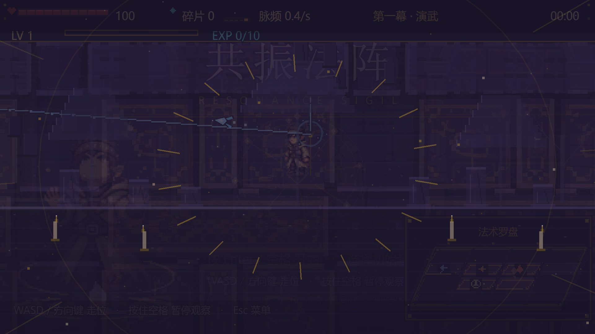
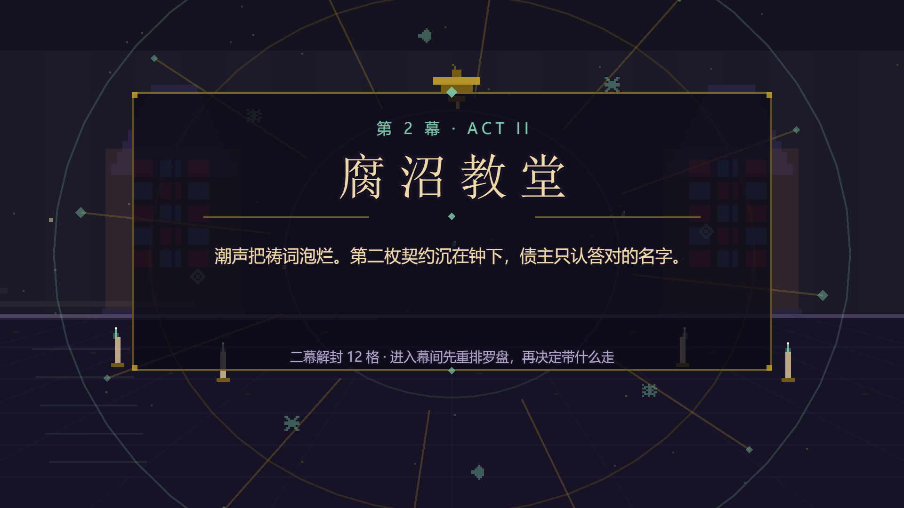
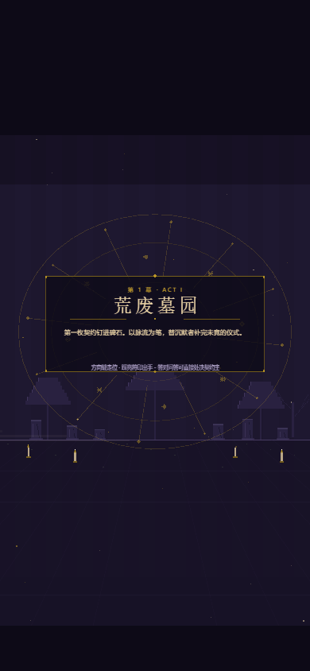
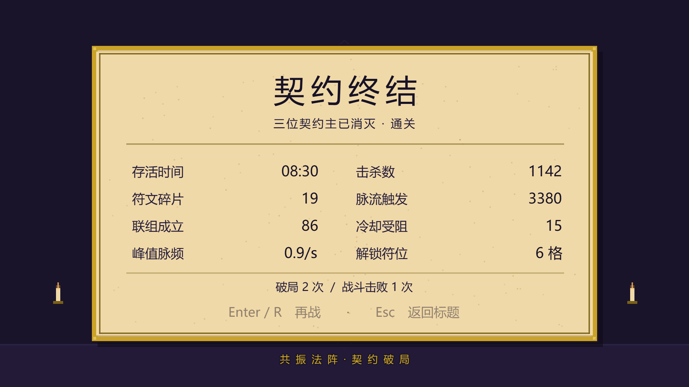

# 过场动画（Cinematics）· 设计、接入与验收

> 目标：把「标题 → 选套 → 三幕战斗 → 幕间 → 终局 / 死亡 / 再战 / 返回标题」的每一次切场都改成**有内容的过场**，并且**无缝**——不黑屏、不闪一帧空场景、输入不穿透、可跳过。
> 接入提交：见 `git log --grep 过场`。

## 一、全流程覆盖

| 触发 | 类型 | 时长 | 画面内容 |
| --- | --- | --- | --- |
| Boot → 标题 | `boot` | 960ms | 祭坛符环收拢、浮尘上升，揭开标题页 |
| 标题 → 选套 | `sigil` | 920ms | 符环扩张 + 黄铜短卡「起手契约」 |
| 选套 → 第一幕 | `act` | 1460ms | 荒废墓园剪影（墓碑/尖拱/枯树/烛火）+ 幕名 + 一句世界观字幕 |
| Boss 通幕 → 幕间 | `clear` | 1420ms | 「契约解除」+ 用时/击杀/脉流/联组四项数据 + 封印碎片飞散 |
| 幕间 → 第二幕 | `journey` | 5840ms | 横移长镜头：走出墓碑群、沼水雾带、教堂彩窗逐格亮灯 + 幕名角标（详见 [开场与幕间.md](开场与幕间.md)） |
| 幕间 → 第三幕 | `journey` | 5840ms | 彩窗暗灭、镜头上摇、星纹垂落、王庭立柱与王座浮现 + 幕名角标 |
| 第三幕通关 → 结算 | `victory` | 1600ms | 三道契约环 + 金色黎明色带 + 「契约终结」 |
| 死亡 → 结算 | `death` | 1120ms | 血色收边 + 灰烬下落 + 「魂火熄灭」 |
| 结算 → 再战 | `retry` | 920ms | 短转场「再入契约」，不重复整张幕名卡 |
| 结算 / 战斗菜单 → 标题 | `return` | 920ms | 「祭坛暂歇」 |

短过场总时长全部落在 **900–1600ms**；幕间 journey 为 **5840ms**（cover 320 / hold 5200 / reveal 320，2026-11-07 起）。任意键/点击可跳过，转入后 150ms 内的那一下不算跳过（防止触发键顺带吞掉转场）。

## 二、为什么是「无缝」的

1. **先盖住，再换场**：旧场景被暂停但仍在渲染；覆盖层完全盖满（`coverMs`）后才 `stop` 旧场景、`launch` 目标场景。注意 `stop` 的判定是 `isActive(from) || isPaused(from)`——真实 Phaser 里 `isActive()` 对 PAUSED 场景返回 false，只查 isActive 会漏停已冻结的源场景（2026-11-07 修复，见下文 bug 记录）。
2. **目标先就绪，再揭开**：目标场景 `create` 完成事件触发后才允许进入揭开阶段；就绪前计时钉在揭开点，绝不露空帧。
3. **揭开前目标处于暂停**：目标在地底下先冻结，揭开那一刻才 `resume`，玩家不会在标题卡期间先走两步/先挨一下。
4. **没有纯黑帧**：覆盖底色是「祭坛暗紫 + 当幕主题色」，再叠墙带、雾、剪影、符环和浮尘；不是 `#000` 的黑场。
5. **跳过也走同一套**：未换场时跳过 = 立刻换场并进入揭开；再次跳过 = 直接结束。不会出现「跳过以后卡在覆盖层」。
6. **兜底**：目标场景 1500ms 内没有派发 `create` 也强制放行，避免把玩家锁在过场里。

## 三、代码结构

    src/data/cinematics.js     纯数据 + 时间轴/阶段/跳过/卡片文案（无 Phaser，可单测）
    src/ui/cinematic-art.js    程序化像素美术：盖场、三幕剪影、符环、浮尘、碎片
    src/scenes/CutsceneScene.js覆盖层场景：盖场 → 换场 → 冻结目标 → 揭开
    src/ui/transition.js       统一入口 playCutscene(scene, { to, kind, act, payload, report })
    src/main.js                过场场景必须注册在场景列表最后（渲染在最上层）

接入点：`BootScene` / `TitleScene` / `LoadoutScene` / `BattleScene` / `IntermissionScene` / `GameOverScene` 所有正式切场都改为 `playCutscene`。
被过场送进来的场景会收到 `__cine: true`，据此跳过自身的 `fadeIn`，避免「过场揭开 + 场景再淡入」叠两层。

## 四、调试开关

| 参数 | 作用 |
| --- | --- |
| `?cine=0` | 关闭过场，退回普通切场（调试/自动化用） |
| `?stress=1` | 压测模式同样关闭过场 |
| `?scene=battle` / `?scene=gameover` | 保留原调试直达；开场过场会在揭开时落到直达场景 |

## 五、真实浏览器验收（已执行）

2026-11-06 在真实 Edge（Playwright `channel: 'msedge'`）里跑通，1920×1080 桌面 + 390×844 竖屏两档。**16 张截图、0 个 pageerror、9 段过场时长全部在 900–1600ms**；逐项断言在 [verify.json](cutscene/verify.json)。

| 第一幕标题卡 | 揭开瞬间（底下的战斗已经就绪） | 第二幕标题卡 |
| --- | --- | --- |
|  |  |  |

| 第三幕标题卡 | 通幕统计 | 竖屏第一幕 |
| --- | --- | --- |
|  |  |  |

| 契约解除 | 魂火熄灭 | 契约终结 |
| --- | --- | --- |
|  |  |  |

| 胜利结算 | 竖屏 390×844 第一幕 |
| --- | --- |
|  |  |

### 无缝的硬证据

标题卡停留时，脚本直接读战斗场景状态：

```json
{ "battleCreated": true, "battleStatus": 6, "cutActive": true }
```

`battleStatus: 6` 是 Phaser 的 `PAUSED`——战斗场景已经 `create` 完成、在覆盖层底下冻结待命，揭开时才放行；`05b-act1-reveal.png` 能看到标题卡淡出后，玩家、HUD 与罗盘已经在同一帧里，没有黑场或空场景过渡。

### 真机踩到并修掉的 bug

首轮浏览器跑「跳过」时，目标场景会永久停在暂停态：`SceneManager` 的 `pause/resume` 是**排队操作**，跳过时 `resume` 可能先于 `pause` 落地，于是 resume 被当成无效操作，随后 pause 生效，目标就再也起不来。修法：

- `freezeTarget` 在已经进入揭开阶段时不再补暂停；
- `resumeTarget` 无条件排 resume，并启动 `ensureTargetRunning` 短计时器看门狗（约 400ms 内反复确认目标不在暂停态）；
- 看门狗带 owner 标记，新过场一开，旧看门狗自动停，不会误放行新过场的目标。

这条是单元测试替身测不出来的（假 SceneManager 会立即应用 pause），只有真实浏览器能暴露；复跑 `scripts/cutscene-shot.mjs` 会持续守住。

2026-11-07 开场动画验收又踩到同族的一条：**PAUSED 源场景泄漏**。`swapScenes` 原来只在 `isActive(from)` 时 `stop` 旧场景，而真实 Phaser 的 `isActive()` 仅对 RUNNING 为 true——被盖场阶段暂停的源场景永远不被 stop，PAUSED 场景仍渲染，于是 StoryScene 的冻结末帧盖住了标题页与后续所有画面（旧流程因目标渲染序在源之上而被掩盖，开场 StoryScene→TitleScene 是唯一源渲染序高于目标的流程，首次踩中）。修法（提交 `fdebbef`）：`stop` 判定改为 `isActive(from) || isPaused(from)`；单测 harness 的 `isActive` 同步对齐真实语义（PAUSED 不算 active）并加回归测试。修复后重跑 `scripts/story-shot.mjs`，标题页/战斗/竖屏标题逐张目检确认正常，证据见 [开场与幕间.md](开场与幕间.md)。

### 离线构图预览（辅助，不是证据）

在没有浏览器权限的阶段，用同一套 `cinematic-art.js` 绘制指令经 Pillow 重放生成的构图检查图仍在 `docs/cutscene-preview/`。几何/颜色/层级一致，但字体光栅化与 Phaser 有差异，**不作为验收证据**。

## 六、复跑与单测

```bash
npm test          # 32 个文件 / 800 项全绿（含 28 项过场单测）
npm run build     # 生产构建通过
node scripts/static-server.mjs dist 4174
BASE_URL=http://127.0.0.1:4174 node scripts/cutscene-shot.mjs
```

> 在受限沙箱里跑浏览器时，把 `TEMP`/`TMP` 指到工作区（`TEMP=$PWD/.tmp/pw-temp TMP=$PWD/.tmp/pw-temp`），否则 Playwright 会在系统临时目录上 `EPERM`。

新增测试：

- `tests/cinematics.test.js`：时间轴总长、阶段边界、跳过语义、三幕文案、卡片数据。
- `tests/cutscene-scene.test.js`：用最小 Phaser 替身跑换场状态机（盖满才换场、目标冻结/放行、目标未就绪不揭开、跳过不会软锁、八类过场都能走完）。
- `tests/transition.test.js`：`?cine=0` 退回、重复触发、无覆盖层、幕号解析。

性能：长透视线/符环辐条从「Bresenham 逐像素 fillRect」换成 1px 矢量线、符环改 48 段折线描边，单帧绘制指令从 **约 8000 条降到 500–700 条**；短装饰线仍保留像素楼梯。

## 七、开场动画与幕间 journey（2026-11-07 扩展）

在本系统之上新增了 36 秒六镜剧情开场（Boot → StoryScene → 标题页）与两段 5840ms 幕间 journey（幕间 → 二/三幕），复用同一套 Cover→Swap→Freeze→Reveal 机制；第一幕入场保持 `act` 标题卡不变。分镜表、真实浏览器验收结果（14 截图 / 11 check / 0 pageerror）与复跑命令见 [开场与幕间.md](开场与幕间.md)，验收脚本为 `scripts/story-shot.mjs`，证据在 `docs/story/`。
